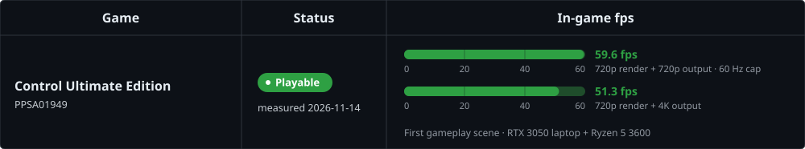

# KytyPS5 (performance fork)

This is a fork of [KytyPS5/KytyPS5](https://github.com/KytyPS5/KytyPS5), a free and open-source
PlayStation 5 translation layer written in C++ for Windows and Linux, with experimental macOS
support. Everything about the project itself (status, compatibility list, building, running,
contributing) is in the [upstream README](https://github.com/KytyPS5/KytyPS5#readme) and applies
here unchanged. This page only says what this fork changes.

> [!IMPORTANT]
> KytyPS5 is not affiliated with Sony Interactive Entertainment or PlayStation. The project does
> not distribute games or copyrighted system software. Use only game files that you have obtained
> legally.

## Control: 60 fps at 720p

> **Control Ultimate Edition (PPSA01949) runs at 60 fps** at 1280x720 with this fork on an **RTX 3050 laptop GPU
> (8 GB) + Ryzen 5 3600**. 60 fps is the display's limit. Right picture, no device loss.

First gameplay scene, six 10 s windows (59.0-59.9 fps). With only its render size at 720p and the output left at
3840x2160 it gives 51.3 fps. Right picture in both.

**[See more games →](docs/games.md)** (Control and Grand Theft Auto V)

**720p:** put `render-720p-output-720p.json` from
[recomp-patches](https://github.com/batatinhafcbatatinha-pixel/recomp-patches) (`ps5/PPSA01949/`)
through that repository's `python tools/recomp_patch.py kyty <patch.json> <out.json>` and start the game with `--game-patch <out.json>`.
The patches hold addresses and values only (no game code); the emulator writes them into the loaded module, and
"held" values are written again whenever the game writes its own. A 1080p variant exists too.

The same renderer now also drives [AnyPS5](https://github.com/batatinhafcbatatinha-pixel/AnyPS5)'s new GPU engine,
where the game code runs natively.

## What differs from upstream

The fork follows upstream `main` (merged regularly; last merge at upstream `15c8c618`). Everything it adds is about
frame rate, is on by default, and can be turned off where a switch is named.

- **Compute work runs ahead on a second GPU queue.** Programs whose results are read back later run early, so the
  GPU thread rarely waits for them. Off: `KYTY_EARLY_COMPUTE=0`.
- **Pages the game rewrites all the time stop being watched.** They are uploaded once per frame batch instead of
  faulting on every write, and only when their bytes really changed. Switches: `KYTY_REWRITTEN_FRAMES=n` (how often
  the list is rebuilt), `KYTY_BDA_HASH=0` (always upload).
- **GPU images are reused.** A deleted image is kept for up to 2 s and handed to the next one of the same shape, so
  shadow maps no longer create and free four images per frame.
- **Texture descriptions are cached** instead of recomputed for every binding, and the descriptor reader avoids page
  faults on pages it just touched.
- **`vkQueueSubmit` runs on its own thread.** Off: `KYTY_ASYNC_SUBMIT=0`.
- **More compute work becomes plain GPU clears and copies.** Fills and whole-image copies that *Control* runs every
  frame are recognised and done as image clears and copies, without reading the data back.
- **Read-back fixes:** GPU-written image data is kept, and downloads start as soon as their batch is submitted.
- **Held values in game patches:** a `--game-patch` entry with `"hold": true` is written again whenever the game
  writes its own value (used by the resolution patches in
  [recomp-patches](https://github.com/batatinhafcbatatinha-pixel/recomp-patches)).
- **Device-loss report:** every failed Vulkan wait or submit prints one `[device-loss]` line with memory usage.

Open points:

- 3 of 20 runs with the second queue lost the GPU device, all in one hour when the PC was short of memory; none
  since. The `[device-loss]` line tells whether memory was the cause; `KYTY_EARLY_COMPUTE=0` goes back to one queue.
- An older attempt at reading descriptors on the GPU is still in the tree but switched off (it no longer fits
  upstream's reworked image heap).

## Building and running

Exactly as upstream: see
[Building](https://github.com/KytyPS5/KytyPS5#building) and
[Running](https://github.com/KytyPS5/KytyPS5#running). Bugs that also happen in upstream's build
belong in upstream's issue tracker; bugs that only happen here belong in this repository's.

## AI use

The changes of this fork were written with AI assistance (Claude models, supervised and tested by
the fork's maintainer on the hardware named above); the commits say how each change was measured.
Upstream asks that pull requests disclose AI involvement and come from a human contributor:
nothing from this fork is sent upstream by an AI agent.

## License

KytyPS5 is licensed under the [GNU General Public License version 2](LICENSE)
(`GPL-2.0-only`), and so is this fork.

This project is based on the original [Kyty](https://github.com/InoriRus/Kyty), which was released
under the MIT License. Kyty's original copyright and license notice are preserved in
[`LICENSES/Kyty-MIT.txt`](LICENSES/Kyty-MIT.txt). Third-party components remain subject to the
licenses included with those components.

## Credits

- [KytyPS5/KytyPS5](https://github.com/KytyPS5/KytyPS5) and its contributors — the emulator itself;
  this fork is a small set of changes on top of their work.
- [InoriRus/Kyty](https://github.com/InoriRus/Kyty) — KytyPS5 is based on a heavily modified version
  of the original Kyty project.
- [shadps4-emu/shadPS4](https://github.com/shadps4-emu/shadPS4) — reference for understanding PS4
  memory behavior, GPU resource aliasing, cache coherency,
  and the AVPlayer implementation.
