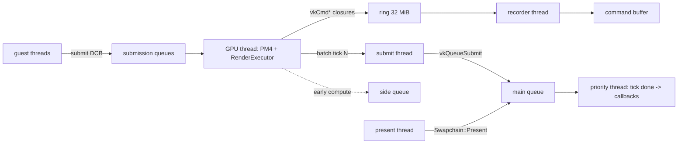

State described: c944a398 (2026-11-23), read 2026-11-25.

# Host GPU side

Structures of the Vulkan back end and of the shader recompiler. The order of work inside one draw, dispatch, flush or flip is in [GRAPHICS_PIPELINE.md](GRAPHICS_PIPELINE.md). Guest-memory copies, write detection, buffer and texture caches are in [MEMORY.md](MEMORY.md). Measured numbers are only in [OPTIMIZATION_LOG.md](OPTIMIZATION_LOG.md).

Conventions: paths are repository-relative. "Fact" = read in the named file. "Hypothesis" = suspected cost, not measured. Nothing in the studies behind this file was measured by them.

Contents: [1 Device](#1-device-set-up) · [2 Objects and threads](#2-renderer-objects-and-threads) · [3 Recorder, scheduler, submission, waits](#3-recorder-commandscheduler-submission-and-waits) · [4 Pipeline cache and shader store](#4-pipeline-cache-and-shader-store) · [5 Descriptors](#5-descriptor-model) · [6 Image heap](#6-image-heap) · [7 Ray tracing](#7-ray-tracing-mirror) · [8 Render targets](#8-render-targets) · [9 Swapchain](#9-presentation-objects-and-swapchain) · [10 Upscalers](#10-upscalers) · [11 Helper shaders](#11-helper-shaders) · [12 Shader recompiler](#12-shader-recompiler) · [13 Switches](#13-environment-switches-of-these-parts)

## 1. Device set-up

Facts (device creation is in `src/graphics/presentation/window/vulkanWindow.cpp`):

- Target API is Vulkan 1.3 (`src/graphics/host_gpu/graphicContext.h:20`, `VULKAN_TARGET_API_VERSION`). A device below 1.3 is rejected (`vulkanWindow.cpp` `VulkanFindPhysicalDevice`, ~line 187). The same constant goes to VMA (`src/graphics/host_gpu/vma.cpp:91`).
- Physical device choice (`vulkanWindow.cpp:145-270`): optional `Config::GetGpuIndex()`, or the OpenXR headset's device. Every device that passes the feature, extension and format checks is a candidate. The first candidate is kept and a discrete GPU replaces it (the last discrete GPU wins).
- Queues (`vulkanWindow.cpp:115-143`, `:636-644`, `:1074-1077`): first family with graphics + compute + presentation. One queue-create entry for that family with `queueCount = 2` if the family has at least 2 queues, else 1; both priorities 1.0. Queue 0 = `graphics.queue`, queue 1 = `graphics.side_queue` (null with 1 queue). No dedicated compute or transfer family. Both queues share the family, so command pools are created for `graphics.queue_family` (`src/graphics/host_gpu/renderer/commandScheduler.cpp:23-32`).
- Queue use: all draws, dispatches, copies, barriers, uploads, downloads and the batch submits go to the main queue (`CommandScheduler::SubmitToQueue`, `commandScheduler.cpp:192-219`, under `graphics.queue_mutex`). Only "early compute" dispatches go to the side queue ([section 3](#early-compute-side-queue)). Presentation calls `presentKHR` holding the graphics queue mutex (`src/graphics/presentation/window/swapchain.cpp:901-931`).

Required device extensions: swapchain, depth_clip_control, image_view_min_lod, push_descriptor, robustness2, maintenance1 (`vulkanWindow.cpp:1033-1036`); depth_clip_enable on non-Apple (`:1042`).

Required features (the device is rejected otherwise, `vulkanWindow.cpp:207-300`, `:56-70`):

| Level | Features |
|---|---|
| 1.1 | `storageBuffer16BitAccess`, `shaderDrawParameters` |
| 1.2 | `samplerMirrorClampToEdge`, `storageBuffer8BitAccess`, `shaderBufferInt64Atomics`, non-uniform indexing (sampled images, storage images, storage buffers), descriptor binding update-after-bind (sampled image), update-unused-while-pending, partially bound, `timelineSemaphore`, `bufferDeviceAddress`, `shaderOutputViewportIndex`, `shaderOutputLayer` |
| 1.3 | `synchronization2`, `dynamicRendering`, `robustImageAccess` |
| robustness2 | `nullDescriptor` |
| core | `robustBufferAccess`, `depthClamp`, `depthBounds`, `samplerAnisotropy` (>= 16), `sampleRateShading`, `depthBiasClamp`, `shaderClipDistance`, `shaderCullDistance`, `largePoints`, `multiViewport`, `fillModeNonSolid`, `fragmentStoresAndAtomics`, `independentBlend`, `dualSrcBlend`, `tessellationShader`, `drawIndirectFirstInstance`, `multiDrawIndirect`, `shaderInt64`, `shaderStorageImageWriteWithoutFormat`, `shaderImageGatherExtended`, `shaderResourceMinLod`, `vertexPipelineStoresAndAtomics`, subgroup vote |

Optional, enabled when present (`vulkanWindow.cpp` `VulkanCreateDevice`, 372-770):

| Extension / feature | Effect on the renderer |
|---|---|
| memory_budget | VMA budget; GC triggers |
| external_memory_host | `graphics.external_memory_host_enabled`; imports guest pages as host memory (comment `~:415`: GPU-SRT reads guest memory through imported host pages) |
| depth_range_unrestricted, extended_dynamic_state | the second only because enabling the feature avoids a driver crash (comment `~:675`) |
| workgroup_memory_explicit_layout, mesh_shader (task + mesh), shader_clock, shader_image_atomic_int64, conditional_rendering, fragment_shader_barycentric, compute_shader_derivatives, provoking_vertex | used by the translator when the guest shader needs them |
| attachment_feedback_loop_layout + its dynamic-state extension | both or neither; used for a draw that samples the depth it writes |
| maintenance8 | needed by the depth-to-colour copy path (`CopyDepthToColor`, else `EXIT_NOT_IMPLEMENTED`) |
| cooperative_matrix, shader_float8 | only when FSR is enabled |
| deferred_host_operations + acceleration_structure + ray_query | ray tracing; see below |
| OpenXR and DLSS extensions | only with those features on |
| `VK_EXT_device_fault`, NV checkpoints, NV diagnostics config | only with `Config::GpuCrashDiagnosticsEnabled()` |

Ray query needs `Config::NativeRtEnabled()` (default `true`, `src/common/emulatorConfig.h:107`). If `vkCreateDevice` fails with those extensions it retries without them and sets `ray_query_enabled=false` (`vulkanWindow.cpp:755-770`).

Derived flags (`vulkanWindow.cpp:~495-560`): `compute_subgroup_size_control_enabled` (subgroupSizeControl and 64 inside min/max), `robust_buffer_access_enabled` (robustBufferAccess2 and `robustStorageBufferAccessSizeAlignment == 1`), r8/r8g8 sRGB view support, `occlusion_queries_enabled` (config and `hostQueryReset`), `mesh_shader_enabled`, `max_push_descriptors`, `device_clock_period_ps`. `robustBufferAccess` is always on (`:~590`). Without `shaderStorageImageMultisample` storage sample counts clamp to 1 (`:~607`).

Allocator (`src/graphics/host_gpu/vma.cpp`):
- VMA with `BUFFER_DEVICE_ADDRESS_BIT`, plus `EXT_MEMORY_BUDGET_BIT` if enabled; no custom pools, no block-size settings (`:77-103`). Images: `VMA_MEMORY_USAGE_AUTO_PREFER_DEVICE` + `WITHIN_BUDGET_BIT` (`:204-251`). Buffer creation is in the caches ([MEMORY.md](MEMORY.md)).
- Image backing pool (`:32-73`, `:204-280`): freed optimal-tiling images without pNext are kept (limit 128 MiB, entries older than 2 s evicted) and reused when `flags, type, format, extent, mips, layers, samples, usage` match. Comment `:32-35`: made for surfaces used alternately as depth and colour, whose creation and free "is slow".
- The recorder is installed after the device functions load and before the allocator (`vulkanWindow.cpp:1084-1086`), so VMA's destroy/free calls pass through the recorder's draining stubs (`src/graphics/host_gpu/renderer/recorder.cpp:1255-1285`).
- Fixed helper compute pipelines are made by `CreateComputePipeline` with a null pipeline cache (`src/graphics/host_gpu/vulkanCommon.cpp:136-151`).

Hypothesis: the image backing pool only helps surfaces whose parameters repeat within 2 s and 128 MiB; images alternating roles beyond that recreate memory (candidate listed in the studies: `vma.cpp:44-45`). Effect measured once: see [OPTIMIZATION_LOG.md](OPTIMIZATION_LOG.md) row 2026-11-17.

## 2. Renderer objects and threads

Facts. `RenderContext` (`src/graphics/host_gpu/renderer/renderContext.cpp`) owns the caches and the scheduler. `RenderExecutor` (`renderDraw.cpp`, `renderCompute.cpp`, `renderPssr.cpp`) holds the entry points the command processor calls. Every `DrawIndex`, `DrawAuto` and `DispatchDirect` takes `m_context.GetMutex()` (`Common::LockGuard`) for its whole body, including all cache lookups and the Vulkan recording (`renderDraw.cpp:1281`, `:1372`, `renderCompute.cpp:328`).

| Object | File | Role |
|---|---|---|
| `RenderContext` | `renderer/renderContext.cpp` | owner; `HandleFault`, `PrepareBda`, `RunGarbageCollector`, `WaitWriteBacks`, `UnmapMemory`; constructs `PipelineCache` and calls `WarmUp` (`:24`) |
| `RenderExecutor` | `renderer/renderDraw.cpp`, `renderCompute.cpp`, `renderPssr.cpp` | draw, dispatch and upscale entry points |
| `CommandScheduler`, `MasterSemaphore`, `CommandPool` | `renderer/commandScheduler.{h,cpp}`, `masterSemaphore.cpp` | batches, ticks, flush, submit thread, deferred operations |
| `Recorder` | `renderer/recorder.{h,cpp}` | replaces the dispatcher's `vkCmd*`; replays on a recorder thread |
| `PipelineCache` | `renderer/pipeline/pipelineCache.{h,cpp}`, `shaders.cpp`, `pipelineSerialization.cpp` | program, module, pipeline lookup; disk store |
| descriptors, `DescriptorHeap` | `renderer/descriptors.cpp`, `descriptorHeap.cpp` | per-draw binding resolution, sets, pools |
| `ImageHeap` | `renderer/pipeline/imageHeap.{h,cpp}` | one large bindless image-array set |
| `RayTracing` | `renderer/rayTracing.{h,cpp}` | host mirror of guest BVHs |
| `ResolveCache` | `renderer/resolveCache.cpp` | memo of resolved colour/depth targets |
| `TextureCache`, `BufferCache`, `StreamBuffer`, `FaultManager`, `SamplerCache` | `renderer/cache/` | see [MEMORY.md](MEMORY.md) |
| `Image`, `CommandBuffer::BeginRendering` | `renderer/image/image.cpp`, `renderer/context.cpp` | layout state, barriers, dynamic rendering pass |
| `DynamicState` | `renderer/dynamicState.cpp` | dirty-bit commit of dynamic state |

Threads that touch this side:

| Thread | Created | Does |
|---|---|---|
| GPU thread (`Thread_Gpu`) | `src/graphics/guest_gpu/graphicsRun.cpp:44` | runs the command processor, hence every draw, dispatch, cache lookup and recording call |
| Recorder thread | `recorder.cpp` (lazily) | replays queued `vkCmd*` into the real command buffer |
| Submit thread | `commandScheduler.cpp:230-262` (lazily, first async submit) | `vkQueueSubmit` of batches in tick order |
| Priority-operations thread | `CommandScheduler` constructor (`:402-429`) | waits a tick, then runs guest-memory completions (read-back publish, flips, interrupts) |
| Shader-store writer | `pipelineSerialization.cpp:113-148` | appends records and saves the driver cache |
| Present thread | `src/graphics/presentation/videoOut.cpp:266` | vblank clock, `FlipQueue::Flip`, `Swapchain::Present` |
| Guest threads | the title | fault handlers run on the faulting thread ([MEMORY.md](MEMORY.md)) |

Hypothesis: the single render mutex plus single GPU thread serialise cache lookups, descriptor resolution and recording; any lookup that waits stalls every other user of `GetMutex`. Whether `PipelineCache` is called from one thread only is not verified (the header says "the owning renderer serializes access", `pipelineCache.h:179`; the constructor asserts the main thread, `pipelineCache.cpp:507`).

## 3. Recorder, CommandScheduler, submission and waits

### Recorder (`src/graphics/host_gpu/renderer/recorder.cpp`)

Facts:
- Purpose (`:1-16`): the GPU thread "spends a large part of every draw inside the Vulkan driver recording commands". The file replaces the dynamic dispatcher's `vkCmd*` pointers. Calls on a command buffer begun by the GPU thread are copied into a ring and replayed by the recorder thread into the real buffer. On by default; `KYTY_RECORDER=0` disables it (`:1294-1298`). If device functions are loaded again it stays off (`:1288-1292`).
- Ring (`:61-228`): one producer (the first GPU thread that begins a deferred buffer, `IsProducer` `:235`), one consumer, 32 MiB. Record = 16-byte header (function pointer, size) + closure + appended array copies. Room per record is the closure rounded to 16 bytes (`ClosureRoom`, `:89-93`; max closure `SlotSize = 192`; `KYTY_X_CUT=b` restores the full slot). A wrap marker skips a record tail. A full ring blocks the producer (kick + spin/yield, `Reserve` `:97-123`).
- Per command on the GPU thread: queue check (cached per thread by epoch, `:296-315`), `Reserve`, argument copy including arrays, a seq_cst store of the write position and a seq_cst load of the sleeping flag (`Publish`, `:140-143`); if the consumer sleeps, a mutex + `notify_one`.
- Consumer (`Run`, `:166-211`): spins up to 4000 `pause` iterations when empty, then sleeps on a condition variable with a 2 ms timeout; publishes `m_read/m_done` every 32 records or at burst end; reads the write position once per burst (`KYTY_X_CUT=f` undoes).
- Copied commands: draws, dispatches, binds (pipeline, index, vertex buffers 2, descriptor sets), push constants, push descriptors, barriers (v1 and v2), blits, copies, clears, resolve, fill, update, dynamic-state setters, begin/end rendering, queries, timestamps, checkpoint, conditional rendering (`:401-458`).
- Not copied (command has pNext or a non-copyable layout, or another thread uses an open deferred buffer): the ring is drained, the call runs on the calling thread (`DrainIfOpen`). List `:482-543`: label/marker, trace rays, indirect-count draws, non-2 `CmdBindVertexBuffers`, `CmdCopyBuffer2` variants, query copy/reset, events, render passes, `CmdPushConstants2`, `CmdBindDescriptorSets2`, others.
- `CmdBuildAccelerationStructuresKHR` is not copied: it drains the whole ring on every call (`:1229-1236`); the trace-rays family also drains.
- Lifetime calls that drain: `vkEndCommandBuffer`, `vkResetCommandBuffer`, `vkAllocate/FreeCommandBuffers`, `vkResetCommandPool`, `vkDestroy` of CommandPool, Buffer, Image, ImageView, BufferView, Sampler, Pipeline, PipelineLayout, DescriptorSetLayout, DescriptorPool, QueryPool, AccelerationStructure, plus `vkFreeMemory` and `vkResetDescriptorPool` (`:573-652`, `:1255-1285`). `Drain` spins/yields until `m_done >= target` (`:147-156`). `vkEndCommandBuffer` drains once per submitted batch.
- `Sync(buffer)` / `SyncAll()` exist for code that uses its own function pointers (upscaler SDKs, ImGui).

Hypothesis: the cost moved from the driver call to copy + ring traffic per command and a hard sync per batch end; every destroy on the hot path (VMA free, retired buffers, `vkDestroy*` in deferred operations) forces a full drain. Test: `KYTY_RECORDER=0` and `KYTY_X_CUT=bcf` A/B; a drain counter does not exist (would be added in `Ring::Drain`).

### CommandScheduler (`commandScheduler.{h,cpp}`, `masterSemaphore.cpp`)

Facts:
- One timeline semaphore (`MasterSemaphore`, `masterSemaphore.cpp:10-20`) numbers batches ("ticks"). `CurrentTick()` is the open batch; `KnownGpuTick()` is a cached atomic refreshed by `getSemaphoreCounterValue` (`Refresh` `:26-39`). `IsFree(tick)` compares with the cache without a driver call; `Wait` checks the cache, refreshes once, then `vkWaitSemaphores(UINT64_MAX)` under `GpuWaits/GpuWaitNs` (`:41-63`). A second timeline `m_side` serves the side queue.
- Command pools: transient, reset per buffer, grow by 4 buffers; a buffer is reused when its tick <= the known GPU tick (`CommandPool::Commit`, `:52-80`). One batch = one primary command buffer begun with ONE_TIME_SUBMIT (`renderer/context.cpp:22-32`).
- `Flush(submit)` = `BufferCache::RecordEagerDownloads()` + `Submit` + `BeginNext` (`:164-168`). Callers of `Flush`/`Finish` are listed in [GRAPHICS_PIPELINE.md](GRAPHICS_PIPELINE.md#6-flush-points-and-batch-submission).
- `SubmitIfIdle` (`:170-179`): before each non-async dispatch, submits the open batch when it holds >= 8 dispatches and the GPU finished every previous batch. Code comment `:171-172`: "8 measured best of 1, 4, 8 and 16 on one title".
- `Submit` (`:535-568`): adds the pending side wait, calls `FlushDeferredTracking()` on the buffer cache, `vkEndCommandBuffer` (recorder drain), takes the next tick, adds the master signal, then queues the batch to the submit thread when `m_async_submit` (`KYTY_ASYNC_SUBMIT`, default on) and the caller is the GPU thread; otherwise `DrainSubmits()` and submits on the calling thread. Comment `:552`: "vkQueueSubmit costs it ~28 us each".
- Submit thread (`SubmitThread`, `:230-262`): a single worker taking batches in tick order; one thread submits at a time (`m_submit_busy`). A thread that waits on a still-queued batch submits it itself (`SubmitQueuedUpTo`, `:265-287`). Each submit holds `graphics.queue_mutex`.
- Deferred operations: `DeferOperation` (normal; run by the GPU thread in `PopPendingOperations` when their tick is free; they release GPU resources) and `DeferPriorityOperation` (run by the priority thread after `m_master.Wait(tick)`; guest-memory completions: read-back publish, flips, interrupts). Priority operations carry an optional `GuestRange` (empty = host-only, absent = all memory) used by `HasPendingPriorityOperations(range)` (`commandScheduler.h:47`). The GPU thread blocks in `WaitPriorityOperations(tick)` before a normal operation of tick T until all priority operations of tick <= T finished (`PopPendingOperations`, `:316-344`, wait at `:341`).
- Descriptor pools recycle through the master semaphore (`descriptorHeap.cpp:70-83`).

### Early compute (side queue)

Facts:
- Needs `side_queue` and `KYTY_EARLY_COMPUTE != 0` (`commandScheduler.cpp:97-100`, read once per process).
- Qualifies (`renderCompute.cpp:423-453`): `BufferCache::IsEarlyProducer(shader_hash)` (program learned as a producer; learning is in the buffer cache, [MEMORY.md](MEMORY.md)); the program has no images, no DMA, no GDS, no image heap, no GPU-written scalar words, no GDS/BDA/fault bindings; `CheckEarly(ranges) == 0` (no queued batch writes its buffers or reads where it writes). Direct dispatches only.
- `BeginSide()` (`:491`) ends rendering, swaps the current command buffer for one from the side pool and begins it. Everything up to `SubmitSide()` (buffer uploads, bindings, the dispatch, read-back copies by `RecordSideDownloads`) goes into it. `SubmitSide()` (`:500`) flushes deferred tracking, ends the buffer, submits to `side_queue` signalling `m_side` = N, and sets `m_side_wait = N`.
- Ordering: the next main-queue `Submit` waits on `m_side >= N` at `eAllCommands` (`:537-540`). The side submit has no semaphore wait on the main queue; its inputs are safe only because `CheckEarly` found no queued batch writing them. `WaitSide` first calls `SubmitQueuedUpTo(UINT64_MAX)` (`commandScheduler.h:80-83`). Side-queue LDS uses its own buffer (`GetSideSharedMemoryBuffer`, `renderCompute.cpp:277`).
- The device-loss report covers both queues (`src/graphics/host_gpu/deviceLossReport.cpp:81-94`).

Measured effect: [OPTIMIZATION_LOG.md](OPTIMIZATION_LOG.md) row 2026-11-14 (early compute).

### Where the GPU thread (or the thread calling it) waits for the host GPU

| Place | Reason |
|---|---|
| `CommandScheduler::Wait(tick)` (`:297`) | if `tick == CurrentTick()`: submit the open batch, wait, start a new one |
| `CommandScheduler::Finish` (`:181`) | submit + `SubmitQueuedUpTo` + wait last tick; callers `graphicsRun.cpp:241` (BufferWait), `:1087` (GDS read), `RenderContext::UnmapMemory` (`renderContext.cpp:146`, when a registered range or pending priority op overlaps), `ShutdownGpu` (`:48`) |
| `RenderContext::WaitWriteBacks` (`renderContext.cpp:86-99`) | host fault on a page with a pending image write-back |
| `BufferCache` (`cache/bufferCache.cpp:262-266`, `:1451-1457`, `:1473`, `:1491-1492`, `:1597-1599`) | synchronous publish, eager-download release, retire of dirty buffers; see [MEMORY.md](MEMORY.md) |
| `TextureCache` eviction/download (`cache/textureCache.cpp:2303-2305`) | waits the current tick |
| `StreamBuffer` wrap (`cache/streamBuffer.cpp:337-339`) | waits the tick of earlier users of the region |
| `FaultManager::ProcessFaultBuffer` (`cache/faultManager.cpp:68-72`) | waits the previous scan of the same area |
| `RayTracing::Prepare` (`rayTracing.cpp:398-402`) | all 8 readback areas in flight and none holds this TLAS |
| `OcclusionQueries::PublishDumps` (`occlusionQueries.cpp:57`) | publish |
| Swapchain (`swapchain.cpp:105`, `:579`, `:52`) | frame pool waits `present_tick`; acquire waits the semaphore slot's tick; destructor waits last tick |
| `Sync::PrepareVideoOutFlip` -> `WaitForSubmitSlot` (`renderer/sync.cpp:52-70`) | flip queue full |
| Recorder `Drain` | waits the recorder thread, not the GPU |

`vkQueueSubmit` itself blocks the submitting thread (worker or caller).

Hypotheses (not measured): a read-back or eviction `Wait(CurrentTick())` submits the batch early and blocks until the host GPU finishes it; frequent flushes shrink batches and add submit and semaphore overhead; `SubmitIfIdle` can split compute batches (many small batches); the recorder `Drain` at `vkEndCommandBuffer` makes each batch end a sync point. Confirmation counters: `GpuWaits`, `GpuWaitNs`, `QueueSubmits`, `Dispatches`.

## 4. Pipeline cache and shader store

Files: `src/graphics/host_gpu/renderer/pipeline/pipelineCache.{h,cpp}`, `shaders.cpp`, `pipelineSerialization.cpp`.

### Two cache levels

1. Program/module cache: `m_program_cache : unordered_map<ProgramKey, Program>` (`pipelineCache.h:255`). `ProgramKey` = {stage, shader hash, user-data count, `static_state` (a `vector<uint32_t>` built by `BuildStageStaticKey` on every call, `shader.cpp:433-558`), runtime_srt flag, scalar_slots flag}. The map hashes only the 64-bit shader hash; variants of one source share a bucket and are told apart by `operator==`, which compares the vector (`:231-245`). `Program` holds a `ResourcePlan`, a snapshot, `specialization` and `modules` (vector of `ShaderModule`).
2. Pipeline cache: `m_graphics_pipelines : unordered_map<GraphicsPipelineKey, Pipeline>`, hashed with `XXH3_64bits` over the key bytes (`pipelineCache.cpp:214-216`), equality by `memcmp` (`:210`); the key is packed and static-asserted to have unique object representations (`pipelineCache.h:101-114`). `m_compute_pipelines : unordered_map<uint64_t module id, Pipeline>` (`:264`, lookup `pipelineCache.cpp:1125`). `m_tess_layouts` is keyed by (LS hash, HS hash, VGT fields) (`:725-733`); `m_scalar_programs` holds scalar-slot learning state per shader hash.

None of these maps is evicted in the code read; modules are freed only in the destructor (`:522-526`). Guest-side map `g_shader_map` (guest address -> metadata + hash, `shader.cpp:53`) also has no removal path seen.

### Keys

| Key | Contents |
|---|---|
| Guest binary hash | XXH3-64 over the code bytes, taken once when the guest maps the shader (`shader.cpp:77-93`, hash `:88`); size from a 0x30-byte footer (`:64-75`). Merged GS front/back: hash of both hashes (`:606-607`) |
| `ProgramKey.static_state`, VS | dynamic-fetch flags/regs, resource count, wave size, scratch/LDS size, `pa_cl_vs_out_cntl`, user clip planes, indirect-draw offsets, clip-space transform floats when clip is disabled (`shader.cpp:447-458`), mesh fields, tessellation layout, per attribute `registers_num / attr_id / swizzle` + channel count + type class (`:486-494`) |
| `static_state`, PS | scratch/LDS, interpolators, system-input flags, `parameter_mode`, kill/z/mask export, early-z, dual-source and alpha-blend source, per-target output mode, packed UNorm/round/uint/sint masks, export mapping, interpolator settings (`:497-541`) |
| `static_state`, CS | workgroup register, wave size + float mode, host subgroup size, thread ids, LDS/scratch, dispatch mode, thread counts per axis, group-id flags (`:543-558`) |
| Module inside a program (`FindModule`, `pipelineCache.cpp:231-251`) | linear scan comparing `layout.push_data_start_dword` and the whole `ResourceSpecialization` (`ResourceMaterialization.h:10-52`), plus callee code for programs with calls |
| Module id (`:266-273`) | XXH3 of stage, hash, user-data count, static state, runtime_srt, scalar_slots, push start, specialization, callee code; stable across runs |
| `GraphicsPipelineKey` (`pipelineCache.h:52-109`) | VS/LS/mesh, HS, TES, PS module ids (0 absent); colour formats[8], depth and stencil format, colour count; vertex input (per binding stride + instance flag, per attribute offset + binding + guest format, counts); depth clip/negative_one_to_one, topology, patch control points, primitive restart, sample count, sample shading, alpha-to-coverage, per-slot write mask, blend factors/ops/enable, provoking vertex, polygon mode |
| Dynamic (not in the key) | viewport, scissor, line width, cull, front face, depth/stencil enables and ops, depth bias, bounds, blend constants, feedback loop (`shaders.cpp:364-388`) |
| Compute pipeline | module id alone |

### Lookup and miss paths

Facts. Per stage per draw, `GetProgram` (`pipelineCache.cpp:309-501`) fills `m_lookup_key`, builds `static_state`, ticks `IR::LearningTick()`, does the map lookup, then `Program::FindModule` runs `MaterializeResources` (re-reads guest user data and SRT-reachable guest memory into a snapshot, `:234`) and scans `modules`. A hit binds the module. Guest descriptor memory is therefore re-read and compared every draw, not only on a miss. Details of that walk: [section 12.3](#123-per-draw-work-for-an-already-compiled-shader).

Misses run synchronously on the GPU thread under the render mutex:
- New program: guest code -> IR (`PrepareShaderSource`, `TranslateProgram`), then `CompileModule` (`:253-307`): `CompileProgram` to SPIR-V, optional validation (`Config::ShaderValidationEnabled`), `vkCreateShaderModule`, counters `ShadersCompiled/ShaderCompileNs`, and a `std::printf` of the compiled-count line per module (`:287-294`).
- New variant of a known program: `GetProgram` calls `TranslateProgram(params.code, options)` again when the entry exists but no module matches (`:477-479`, `:499`); the translated Program is not retained. Call-programs reuse the decoded source (`:469-476`).
- New pipeline: `CreatePipelineInternal` (`shaders.cpp:202-424`) builds shader stages and a new descriptor-set layout and pipeline layout for every pipeline (`CreateLayouts`, `:80-142`); rect-list pipelines also compile two generated tessellation modules (`:222-228`, destroyed after creation `:421-423`); `vkCreateGraphicsPipelines(driver_cache, 1, ...)` at `:417` (compute `:453`; compute pipelines request a required subgroup size when supported, `:433-438`). Counters `PipelinesCreated/PipelineCreateNs` (`pipelineCache.cpp:1113-1117`).
- No pipeline libraries, no `VK_EXT_graphics_pipeline_library`, no async compile, no background creation outside warm-up. On a miss the draw stalls on translation, SPIR-V module creation and the driver's pipeline compile.
- `ValidateShaderSpirv` (`:135-164`) is the only SPIRV-Tools use and returns at once unless `Config::ShaderValidationEnabled()` (default false, `emulatorConfig.h:86`). The SPIR-V reaches the driver as emitted.

### Disk

- Driver pipeline cache (`InitializeDriverCache`, `pipelineCache.cpp:530-603`): Release builds only and only when the title id is known (`_PipelineCache/<id>.bin`). Header `KytyPC2:` + vendor, device, driver version, `pipelineCacheUUID`, then XXH3 of the payload (`:80-90`, check `:552-573`); mismatches invalidate. Saved by the store thread at most once per minute after a pipeline creation (`DriverCacheSaveInterval`, `:46`, `:605-616`) and on `Save()`.
- Shader store `_PipelineCache/<id>.shaders` (`ShaderStorePath`, `:196-208`): needs a Release build, `Config::ShaderCacheEnabled()` (struct default `false`, `emulatorConfig.h:87`; command-line `--shader-cache`, `main.cpp:214`; the launcher's saved configuration defaults to on, `src/launcher/include/configuration.h:137`, and passes `--shader-cache`, `src/launcher/src/mainDialog.cpp:290`, so a title started from the launcher uses the store unless the box is cleared), no graphics debug dump, no fixed GPU-SRT mask. Header = build stamp (executable mtime, or `KYTY_SHADER_CACHE_STAMP`), `SpirvProfile`, `maxComputeSharedMemorySize`, `GpuSrtStoreTag` (`pipelineSerialization.cpp:47-84`); any difference discards the file (`:180-188`). Records, zstd level 3 with XXH3 checksum, append-only, written by the `ShaderStoreWriter` thread: Module (key, resource plan, module info, specialization, SPIR-V), GraphicsPipeline (key bytes), TessellationLayout (`:36-43`, `:127-140`, `:300-331`). Modules of programs with calls are not stored (`pipelineCache.cpp:303-305`).
- Warm-up (`WarmUp`, `pipelineSerialization.cpp:150-226`, called from `renderContext.cpp:24` inside the `RenderContext` constructor): reads the store, runs `LoadRecord` serially (zstd decode, `LoadResourcePlan` that rebuilds the walker code, `vkCreateShaderModule` per module, `:263-270`), then creates every stored graphics pipeline and compute pipeline with `Common::ParallelFor` (serial on NVIDIA/Linux because of a driver crash comment, `:167-175`). Logs "Shader cache: loaded ... in N ms" (`:219`).
- The shader-store `GpuSrtStoreTag` and warm-store layout fix: see [OPTIMIZATION_LOG.md](OPTIMIZATION_LOG.md) (2026-11-21).

Hypotheses (not measured): without `--shader-cache` every start recompiles all shaders in-frame; with it every rebuild of the executable drops the store unless `KYTY_SHADER_CACHE_STAMP` is set; the serial `LoadRecord` loop delays start; key explosion (render formats, blend, vertex layout in the pipeline key; descriptor-derived specialisation in the module key) multiplies `vkCreateGraphicsPipelines` calls; a new descriptor-set and pipeline layout per pipeline adds creation cost; the `std::printf` per module is stdout I/O per new module. Confirmation: counters `ShaderCompileNs`/`PipelineCreateNs` (peak), the "Shader cache: loaded" line. Measurement gap: `ShaderCompileNs` wraps `CompileModule` only (`:257-259`), not `TranslateProgram`.

## 5. Descriptor model

Facts:
- Per pipeline, set 0 is that pipeline's own layout (`CreateLayouts`, `shaders.cpp:80-142`), bindings from the stages' `descriptor_mask`, binding number `NativeBinding(stage, kind)`. Kinds (`renderer/descriptors.cpp:55-75`): sampled-image arrays, storage-image arrays, `Samplers` (separate), storage buffers for `Buffers`, `Gds`, `BdaPagetable`, `FaultBuffer`, `FlattenedSrt`, `ShaderData`, `SharedMemory`. No uniform buffers, no combined samplers, no descriptor buffers.
- Push descriptors vs pool: `uses_push_descriptors = descriptor_count <= max_push_descriptors` (`shaders.cpp:117`). Push: `vkCmdPushDescriptorSetKHR` with the writes at every draw/dispatch (`descriptors.cpp:1420`). Pool: `DescriptorHeap::Commit(layout)` hands out one of a batch of 32 sets (`descriptorHeap.cpp:34-39`, batch size `descriptorHeap.h:25`), `vkUpdateDescriptorSets` on the device (not through the recorder), `bindDescriptorSets` (`descriptors.cpp:1424-1432`). Pool sizes: 1024 sets, 8192 storage buffers, 8192 sampled images, 1024 storage images, 1024 samplers (`descriptorHeap.cpp:11-17`). Exhausted: retire the pool with its tick, reuse the oldest completed (may `Refresh` the timeline), else create another (`:70-83`). Sets are not freed individually.
- Push constants: one range of `NativePushConstantSize` = `sizeof(PushData)` (128 bytes, `ShaderIR.h:516-517`). Stage "shader data" dwords (user data, memory offsets, memory sizes, dispatch extents, ray-query context address) are placed per stage into one `PushData` and pushed per draw (`descriptors.cpp:1406-1416`). Draw-level dwords (object id, mesh params, user-clip planes) are pushed separately (`renderDraw.cpp:1161-1185`). `flattened_srt` and `shader_data` can also be bound as storage buffers filled through the Stream utility buffer (`NativeUpload`, `descriptors.cpp:1127-1133`, 256-byte aligned `:743-749`).
- Buffers: every guest buffer descriptor (V#) becomes a `VkDescriptorBufferInfo` into a cache buffer (`NativeStorageBuffer`, `:116-152`): offset aligned down to `minStorageBufferOffsetAlignment`, the remainder sent in the packed "memory offset" push dwords (max 255), size sent as a push dword; null or zero ranges bind a null descriptor (`nullDescriptor`). Exceeding `maxStorageBufferRange` is an `EXIT`. A written buffer calls `ObtainBuffer(..., written=true)` and `TextureCache::InvalidateMemoryFromGPU(address, size)` per draw (`:148-150`).
- Image descriptors: `desc_memo` (thread_local, 8192 entries, `:536-549`, `:685-687`) memoises image descriptions; not used for heap images or with `--lod-stats`. Mip-dynamic images get one view per mip as an array of descriptors (`RebindImages`, `:1155-1167`). Samplers are cached by descriptor words in `SamplerCache` (key = 4 sampler words + integer-border flag, one `vkCreateSampler` per key, [MEMORY.md](MEMORY.md)).
- Direct memory access: shaders that use device addresses (`uses_dma`) get `BdaPagetable` and `FaultBuffer` bindings (`descriptors.cpp:1354-1364`). `RenderContext::PrepareBda` (`renderContext.cpp:165`) calls `BufferCache::SynchronizeBda(m_mapped_ranges)` and arms `ProcessFaultBuffer` for the next garbage collection (`:175-187`). `BufferCache::CACHING_PAGEBITS` is passed to the BVH shaders (`rayTracing.cpp:585`). Page table internals: [MEMORY.md](MEMORY.md).
- Global-load fallback: every dispatch/draw pre-caches 3 pages after each scalar-loaded base (`CacheDmaBases`, `BackDrawAddressBases`, `FindBuffer(page,1)` each) so loads of uncached pages do not read zero.
- Barriers inside `CommitBindings` (`:1295-1334`): each bound image is `Transit`ed to its read layout / GENERAL / attachment layout before the descriptor write. GDS buffers get a buffer barrier plus `EndRendering` (`:1284-1293`) each time they bind.
- `MarkWrittenTable` hashes up to 1 MiB of a bound descriptor table per draw (`:887-995`).

Hypotheses: descriptor write arrays are rebuilt per stage per draw; the pool path allocates a set per draw (batched by 32) and updates it on the GPU thread; `FindBuffers/ObtainBuffer` and two stream-buffer copies per stage per draw are paid for every buffer; `MarkWrittenTable` costs a hash per draw using written tables. Confirmation: profiler self-time of `CommitBindings`, `RebindBuffers`, `ObtainBuffer`. See [GRAPHICS_PIPELINE.md](GRAPHICS_PIPELINE.md#9-work-paid-per-draw--dispatch--batch--frame) for the per-draw list.

## 6. Image heap

Facts (`renderer/pipeline/imageHeap.{h,cpp}`):
- One descriptor set, binding 0 = 65536 sampled-image elements (`IR::ImageHeapCapacity`, `ShaderIR.h:465`), update-after-bind + partially bound + update-unused-while-pending, all stages, set index 1 (`ImageHeapSet`); one pool, one set (`imageHeap.cpp:81-129`). Used by shaders that index guest image tables with GPU-computed offsets.
- A guest descriptor table (keyed by base address) is a `Memory`. Each "view" (step, first offset, limit, profile) owns a device-local `Buffer` of slot words (one u32 per table dword, `SlotBuffer`, `:60-66`) naming an element index. Shaders read the slot buffer by device address and index the global array.
- Per draw/dispatch that uses the heap: `Acquire` (from program materialisation) refreshes the table snapshot once per draw (`Refresh`: reads dirty pages through `TryReadBufferBacking`, diffs, widens `changed` ranges; table pages are write-watched through `PageManager::UpdatePageWatchers`, so CPU writes fault and mark dirty, `InvalidateMemory` `:280`). `Rebind(executor)` takes image changes (`Image::heap_changes`), re-resolves stale/pending elements through `ResolveTexture`, repoints slot words of stale elements (`Repoint`, walks every view's probes while `remaining != 0`) and issues `vkUpdateDescriptorSets` for new elements (`WriteDescriptors`, `:589`). `Commit` uploads dirty slot ranges through the Stream buffer + `CopyFrom`, retires released elements, transits images back to read layout through `m_away`, binds the set (`:604-655`).
- Tables < 64 KiB are dropped after one idle frame, larger after 32 (`:25-26`, `:680-691`); an unmapped table drops at `UnmapMemory`. Element indices are freed only once their upload's tick is free (`Allocate`, `:464-481`).
- `GlobalEntry` always returns "none", so GPU-SRT global maps are not used (`imageHeap.h:37-41`).

Hypothesis: `Refresh`, `Repoint`, slot upload and `TakeChanges` sorting are per-draw work for every draw that uses the heap (zones `ImageHeap::Rebind`, `Commit`). Unmeasured.

## 7. Ray tracing mirror

Facts (`renderer/rayTracing.{h,cpp}`, only when `ray_query_enabled`):
- Design (`rayTracing.h:22-30`): the guest builds and refits BVHs on the GPU; the host mirrors them. Guest BVH header formats 1, 3, 6 and 10 are converted by compute jobs into triangle/box inputs of host acceleration-structure builds; the host reads back only what sizes the builds. A guest TLAS instance names a (BLAS, subtree root) pair; each pair is one host BLAS over the prim-record range of the subtree. (The log also lists format 9 added on 2026-11-19; the header comment lists 1, 3, 6, 10.)
- Entry: `RayTracing::Prepare(tlas_address)` is called from `PrepareRayQuery` (`renderCompute.cpp:256-266`) for every compute dispatch whose program has recognised ray traversal (`bindings.ray_query_dword`). It returns the device address of a context struct (valid flag, instance count, host TLAS address at +16, guest instance array at +24, `rayTracing.h:32-41`). The translated shader runs the guest ray query on the mirrored TLAS with host `rayQuery` (profile flag `ray_query`, `pipelineCache.cpp:192`). Without native RT "the BVH walks stay emulated" (`emulatorConfig.h:107`).
- Each `Prepare` (`rayTracing.cpp:394-669`) records into the current command buffer: a state `updateBuffer` + `fillBuffer`; 2-3 compute dispatches through a push descriptor set (Walk: one group per pair needing a walk; Triangles: one group of 64 per BLAS chunk; Boxes; Instances); BLAS builds for pairs flagged rebuild or update (one `vkCmdBuildAccelerationStructuresKHR` over disjoint scratch ranges, `ALLOW_UPDATE | PREFER_FAST_TRACE`, update mode when the BLAS geometry hash changed); a TLAS build of `instance_slots` on every call (64 slots initially, `rayTracing.h:101`); a copy of the state buffer into one of 8 readback areas (`Areas`, `:51`); 5 pipeline barriers (all-commands <-> all-commands + host read).
- Readback loop: each call checks `Collect()` (`:284`): areas whose tick the GPU finished are applied (`Apply`): BLAS hashes, walk results (range, box count, link hash), missing pairs, `used` flags. New or changed BVHs get their mirror "a few readbacks later" (header comment), so frames can use stale or invalid mirrors first (context `valid`).
- Stalls: if the area slot is in flight and no area holds this TLAS the thread waits for it (`:398-402`). Buffer growth uses `Reserve` + `Retire`. `buildAccelerationStructuresKHR` drains the recorder ring (`recorder.cpp:1229-1236`).
- GC: every 64 suspend points (`EvictFrames`) unused TLASes, pairs and BLASes are retired (`RunGarbageCollector`, `:671-731`).
- Shaders: `gpu_bvh_mirror.comp` (modes walk/triangles/boxes/instances), `gpu_test_ray_query.comp` (test).
- Emitter side (software BVH fallback, loop guard, ray-query lowering): [section 12.5](#125-wave-and-lane-emulation-special-shapes).

Hypothesis: each ray-query dispatch pays 4+ dispatches, 5 all-commands barriers, a TLAS build of all slots, a readback copy, a state fill and a recorder drain. Confirmation: profiler zone around `Prepare`, count per frame. Measured cost of the traversal programs themselves: [OPTIMIZATION_LOG.md](OPTIMIZATION_LOG.md) (rows 2026-11-21, 2026-11-22).

## 8. Render targets

Facts:
- Colour (`renderer/colorRenderTarget.cpp:42-257`): `HW::RenderTarget` registers become an `ImageDesc` (tile mode, extent, levels, layers, samples, format via `TextureGetRenderTargetFormat`, DCC/CMASK ranges + clear word, single-mip view, layer range, usage ColorAttachment) and `TextureCache::FindImage` finds or creates the image ([MEMORY.md](MEMORY.md)). `ResolveCache` memoises the result per slot while the 8-slot register struct is byte-identical and `Reuse` passes. Max 8 attachments (`renderTarget.h:11`). Unsupported combinations `EXIT`: multisampled non-tiled or multi-mip, texture-tiled + MSAA, 1D/3D + MSAA, linear 3D. Samples come from `num_fragments`; 2 samples/1 fragment is approximated as 2x MSAA with a warning (`:74-87`). Mip 0 is forced when a one-level surface selects mip > 0 and the pitch equals mip 0's (`:161-169`).
- Depth (`depthRenderTarget.cpp`): `MakeDepthTargetDesc` (`:~124`): `FindDepthFormatPolicy` -> host format (stencil formats tried in order through cached `GetImageFormatProperties`, `:98-120`), extent from `DB_DEPTH_SIZE`, HTile range, view layers; many guest states are `DepthFatal`. Depth is skipped when neither depth nor stencil is active (`:~274`); `attachment_unbound` is ignored (`:~285`). Depth write flag = test && write && !write-disabled && !clear. Comment `:262-264` (quoted, not measured here): when HTile is not bound the per-frame fast clear never lands and "NaN depth makes one compute pass ~95 ms (60 -> 10 fps)" for the title it was written for.
- Clears: a depth/stencil clear becomes `loadOp=eClear` on the next `BeginRendering` of that image (`context.cpp:62-73`); the pass state then keeps `depth_clear=false` so later draws reuse the open pass; a later clear starts a new pass. HTile "meta clear" flags (`TextureCache::IsMetaCleared/TouchMeta`) become load-clear aspects (`renderDraw.cpp:482-494`). Compute-based metadata clears are consumed by `TryConsumeComputeMetaClear` ([GRAPHICS_PIPELINE.md](GRAPHICS_PIPELINE.md#5-a-compute-dispatch-step-by-step)).
- Load/store (`context.cpp:54-72`): colour always `eLoad` + `eStore`; depth/stencil `eLoad` unless cleared, `eStore` always. `DONT_CARE` and `LOAD_OP_NONE` are not used.
- Pass reuse (`CommandBuffer::BeginRendering`, `context.cpp:43`): an open pass is reused if `RenderState` compares equal, else ended and a new dynamic-rendering pass begins. There are no subpass dependencies; ordering comes from `Image::Transit` and buffer barriers.
- Layouts (`renderDraw.cpp:454-523`): GENERAL when the image is also bound as texture/storage in the draw (`image.binding.is_bound`), else COLOR_ATTACHMENT_OPTIMAL; depth uses `depth_attachment_layout` or the feedback-loop layout when the draw samples depth it also writes, GENERAL if the extension is missing.
- Barriers (`Image::GetBarriers`, `renderer/image/image.cpp:123-222`): none if layout and access are unchanged and the previous access had no write bits; so a storage image written then re-bound as storage gets a barrier on every `Transit`. Destination stage for non-transfer access is `AllGraphics|ComputeShader` (`:233-236`). Whole-image barriers use `VK_REMAINING_*`; images with per-subresource state get one barrier per (mip, layer).
- MSAA: 1/2/4/8 samples (2 bits, `renderTarget.h:36`); all attachments of a pass need one sample count (pipeline-key build `EXIT`s on mismatch, `pipelineCache.cpp:976-981`, `:1040-1045`); mismatching attachments are dropped first (`renderDraw.cpp:862-879`).
- Resolves: guest colour-control mode 3 -> `Image::Resolve` (copy if the source is 1x, else `vkCmdResolveImage`) on the main command buffer with transfer layouts (`renderDraw.cpp:1442-1472`, `image.cpp:399-448`). No in-pass resolve attachments (`resolveMode` unused).
- Write-back of render targets to guest memory is off by default (config flags in [MEMORY.md](MEMORY.md)).

Hypotheses: any non-trivial layout transition, GDS barrier, copy or write hazard ends the dynamic rendering pass, and with `eLoad/eStore` always, each break re-loads attachments (relevant on tile-based GPUs); resolving render targets per draw when registers did not change costs time (profile figure in [OPTIMIZATION_LOG.md](OPTIMIZATION_LOG.md), 2026-11-16). Confirmation: count `beginRendering` vs `draw`, barriers per frame.

## 9. Presentation objects and swapchain

Flow of a flip is in [GRAPHICS_PIPELINE.md](GRAPHICS_PIPELINE.md#8-flip-and-present). Structure (`src/graphics/presentation/window/swapchain.cpp`):
- `Presenter::PrepareFrame` takes a frame from a pool, resolves the registered surface to an image, configures the frame, calls `Frame::CopyFrom` (end rendering, transition both images, `copyImage` with the smaller of the extents, `:208-222`), optionally hands the frame to the headset runtime (`:937-965`). Blank frames are cleared (`:967-987`).
- `Presenter::Impl::Present` (`:1042-1097`) times `PresentNs`, switches HDR colour space, acquires the next swapchain image (`PresentAcquireNs`), builds the system overlay (`OverlayNs`), records present commands, submits and calls `Swapchain::Present`, retrying twice on recreate/lost results (`DroppedPresents` after two failures).
- `RecordPresentCommands` (`:756-890`) chooses between a linear blit and a shader draw, applies aspect fitting when stretch is off (`:609-622`), clears letterbox areas, draws overlay layers, transits to `ePresentSrcKHR`.
- `Swapchain::Present` waits on the render-complete semaphore and calls `presentKHR` holding the graphics queue mutex (`:901-931`, call `:914`).
- Present mode from config (default `Mailbox`), Immediate or Fifo; falls back to Fifo when unsupported (`:436-450`). Frame ids are not a pacing primitive.
- Waits: frame pool waits `present_tick` (`:105`), acquire waits the semaphore slot's tick (`:579`), destructor the last tick (`:52`).
- Colour-space (HDR) and system-overlay shaders: `gpu_video_out_overlay.frag`, `gpu_video_out_hdr10_to_sdr.inc`.

Hypothesis: each presented layer pays two full-surface operations (copy into a frame, then blit or draw into the swapchain image) plus barriers per frame, possibly significant at high output resolutions; measured only indirectly (output resolution sensitivity, [OPTIMIZATION_LOG.md](OPTIMIZATION_LOG.md), 2026-11-15). The system overlay adds a pass when active or when debug counters are on (`:1072-1078`).

## 10. Upscalers

Facts:
- Guest PSSR request: input/output/depth/motion/exposure descriptors, size, context, position, jitter, motion scale, pre-exposure, flags (`src/graphics/guest_gpu/pssr.h:20-38`); `CpOpPssr` copies it and calls `CommandProcessor::ProcessPssr` (`pm4Handlers.cpp:880-889`, `graphicsRun.cpp:983-986`).
- `RenderExecutor::ProcessPssr` validates descriptors and builds shader resources (`renderer/renderPssr.cpp:90-108`). `RenderExecutor::Upscale` keeps up to four upscaler contexts, creates or replaces one when size or backend changes, wraps each evaluation in two all-stage memory barriers (`:22-35`, `:69-74`) and calls `feature->Evaluate` (`:46-88`). Upscalers record with their own function pointers, so the recorder is `Sync`ed.
- Backends: DLSS and FSR (libraries loaded at start, `vulkanWindow.cpp:949-950`, `:1079-1081`; FSR loaded only for the matching `GetPssrUpscaler` choice and `ProEnabled`, `renderer/upscaler/fsr.cpp:138-143`; DLSS `dlss.cpp:224`), or the compute `gpu_pssr_linear.comp` (default upscaler `Linear`, `emulatorConfig.h:75`).

Hypothesis: context churn and the two barriers are paid per upscaled frame. Confirmation: count `Create/Evaluate`, time them, vary render size.

## 11. Helper shaders

Under `src/graphics/host_gpu/shaders` (purpose from file headers and names; use sites outside the listed files not read):

| Shader | Purpose |
|---|---|
| `fault_buffer_process.comp` | scans the BDA fault bitmap (4 words per invocation) |
| `gpu_bvh_mirror.comp` | guest BVH -> host acceleration-structure inputs |
| `gpu_dispatch_clamp.comp` | indirect-dispatch group clamp/extent; one thread, 4096-slot x 32-byte ring (`renderCompute.cpp:603-657`) |
| `gpu_mesh_indirect.task` | task shader for indirect mesh draws (`MeshTaskParams`, `renderDraw.cpp:602`) |
| `gpu_pssr_linear.comp` | linear PSSR fallback |
| `gpu_blit_color_to_ms_depth.frag` + `gpu_blit_fs_triangle.vert` | MSAA depth blit |
| `gpu_test_ms_depth.comp`, `gpu_test_ray_query.comp` | tests |
| `gpu_tiler_*.comp/.inc` | guest tiling <-> linear per tile mode (standard 256B/4K/64K, 3D variants, depth, render target, PRT), colour clear/transform, D16 promote/demote |
| `gpu_video_out_overlay.frag`, `gpu_video_out_hdr10_to_sdr.inc` | presentation |

All helper compute pipelines use no pipeline cache (`vulkanCommon.cpp:136`). Tiler pipelines are created lazily per (direction, tile family, bytes/element) with specialisation constants (9 families, `renderer/image/tiler.cpp:207-224`; [MEMORY.md](MEMORY.md)).

## 12. Shader recompiler

Folder `src/graphics/shader/` (45,464 lines). Paths in this section are relative to `src/graphics/` unless they start with `src/`.

### 12.1 Pipeline: guest bytes to `VkShaderModule`

Entry per draw: `RenderExecutor::PrepareDrawRenderState` -> `PipelineCache::GetGraphicsPrograms` (`host_gpu/renderer/renderDraw.cpp:832`, `pipelineCache.cpp:683`), pixel stage first (`:902`), then 1 vertex stage (3 with tessellation, `:911-913`); `PrepareProgram` fills the input info from registers (`shader/shader.cpp:560-725`). Dispatch: `GetComputeProgram` (`renderCompute.cpp:373`, `:690`; `pipelineCache.cpp:916`).

| # | Stage | Function | Output |
|---|---|---|---|
| 0 | Hash | `ShaderMapUserData` (`shader.cpp:77-93`) | `ShaderParams{code span, user_data[40], hash, back_code}` (`shaderCompiler.h:17`) |
| 1 | Source | `ShaderRecompiler::PrepareShaderSource` (`recompiler/ShaderRecompiler.cpp:482`): `DecodeProgram` / `DecodeFrontProgram` / `DecodeFusedProgram` (fuses merged front and back, `:440`); `PrepareCallTargets` if the code has `S_SWAPPC_B64` (`:495-498`) | `Decoder::Program` |
| 2 | CFG | `CFG::BuildGraph` (`:532`), `CFG::Structurize` (`:546`); irreducible or unsupported flow keeps the native graph and sets `dispatcher_fallback` (`:541-557`, `frontend/translate/Translate.cpp:1025`) | `CFG::Graph` |
| 3 | Embedded vertex fetch | `DetectEmbeddedVertexFetch` (`:194-438`), VS/LS with dynamic fetch when the GPU vertex-fetch part is off (`:569-579`) | `EmbeddedFetchPlan` |
| 4 | IR translation | `Frontend::TranslateProgram` (`:591`, def `Translate.cpp:992`) | `IR::Program`, wave-register based |
| 5 | SSA | `IR::RewriteToSsa` (`:596`) | Phi form |
| 6 | Simplify x2 | `ConstantPropagationPass`, `RemoveIdentities`, `EliminateDeadCode` (`:597-602`, `:610`), `EliminateReadLane` between (`:603`) | folded IR; read-lane/prefix-scan idioms become subgroup reductions (`ReadLaneElimination.cpp:101,188`) |
| 7 | Tessellation lowering | `LowerTessellationMemory` (`:617`) | LS/HS/TES ring accesses become attribute accesses (`Tessellation.cpp:77`) |
| 8 | Resource tracking | `IR::TrackResources` (`:625`; `ResourceTracking.cpp:4997`) -> `Tracker::Run` (`:727`): `ForwardPrivateLds`, `FoldBoundedLoopSelectors`, `PlanScalarReads`, DCE, `PlanIndirectDescriptors`, `Collect` per instruction; `RecognizePatternFill` (uniform fill, `:5001`) | `Program.info`, `srt_reads`, descriptor sources, `memory_info` |
| 9 | Resource plan | `ExtractResourcePlan` (`ResourceMaterialization.cpp:1519`, called `pipelineCache.cpp:484-487`); `DerivePlanState` JIT-compiles the walker (`CompileSrtWalker`, `:1515`; x86 through Xbyak, `ir/passes/SrtWalker.cpp:1797`) | `ResourcePlan` + walker code |
| 10 | Materialise (per draw) | `MaterializeResources` (`ResourceMaterialization.cpp:2077`) | `ResourceSnapshot` + `ResourceSpecialization` |
| 11 | Specialise | `ApplyResourceSpecialization` (`:2137`, called `ShaderRecompiler.cpp:689`), value graph pruned (`:690-730`) | Program with descriptor-dependent facts baked |
| 12 | Late passes | `TraceTraversalsWithRayQueries` if profile `ray_query` (`:734-739`); `LoadGpuScalarSlots` for the scalar-slot variant (`:740`); `CollectShaderInfo` (`:742`) | `CompiledShaderInfo` pieces |
| 13 | SPIR-V | `Spirv::EmitProgram` (`backend/spirv/SpirvEmitter.cpp:77`) -> `DefineModule`, `EmitProgram` (`spirvEmitterProgram.cpp:709`) -> `SpirvBuilder::Build` | SPIR-V words |
| 14 | Module | optional dump/validate (`pipelineCache.cpp:276-277`), `CompileSPV` = `vkCreateShaderModule` (`host_gpu/vulkanCommon.cpp:126`) | `ShaderModule{id, module, info, specialization}` |
| 15 | Pipeline | `CreatePipelineInternal` (`shaders.cpp:417`, `:453`) with the driver `VkPipelineCache` | `PipelineCache::Pipeline` |

Pass purposes come from names and comments only: ConstantPropagation (full/empty EXEC masks have constant predicates, `ConstantPropagation.cpp:834-835`), ReadLaneElimination, RayQueryTraversal (replaces recognised BVH traversal loops by Vulkan ray queries).

There is no SPIRV-Tools optimiser in the path (see section 4).

### 12.2 Keys, caches, invalidation

Keys and caches are in [section 4](#4-pipeline-cache-and-shader-store). Extra recompiler-side caches: `m_scalar_programs`; `Program::call_source` (only programs with GPU-selected calls, refreshed per draw, [12.4](#124-programs-with-gpu-selected-calls)); the driver cache and shader store.

### 12.3 Per-draw work for an already compiled shader

Facts. `GetProgram` runs for every stage of every draw and dispatch (`pipelineCache.cpp:902-913`, `:923`). On a hit it does, in order:
1. `ShaderGetMappedData` (mutex + map lookup, `shader.cpp:95-105`) and the register-to-info fill in `PrepareProgram`.
2. For a VS with dynamic vertex fetch and no GPU vertex-fetch part (the default; `GpuSrtDefaultParts = 0`, `ShaderIR.h:48`): `ShaderApplyAttribSemantics` reads one attribute dword and one 16-byte V# per input semantic from guest memory, `ShaderDetectBuffers` merges them (`shader.cpp:165-222`, `:123-163`, called `:326-327`).
3. `BuildStageStaticKey` (vector refill), `LearningTick`, `IsRuntimeProgram` (mutex + hash-set lookup, `ResourceTracking.cpp:101-106`), `m_scalar_programs` lookup, `m_program_cache.find` (`pipelineCache.cpp:343-369`).
4. `MaterializeResources` (through `FindModule`, `:234`): the SRT walk.
5. `FindModule`: linear scan of `Program::modules` comparing `ResourceSpecialization` (three vectors of structs, `:238-249`).
6. `bind`: stores module/resources in the input info and `AdvancePushData` (`:428-430`).
7. Later `GetGraphicsPipeline` builds a `GraphicsPipelineKey` and does `try_emplace` (XXH3 over the key bytes + memcmp on a hit, `:956-1104`).

The SRT walk. The guest's shader resource table: user SGPRs hold pointers/values; the shader reads descriptors (V#/T#/S#) and constants by chained scalar loads from guest memory. For ordinary programs the recompiler does not emit those loads on the host GPU. `ExtractResourcePlan` keeps the value graph that produces descriptor words, scalar reads (`srt_reads`) and branch conditions and compiles it to x86 with Xbyak (`SrtWalker.cpp:500-505`, `:1797-1800`). `WalkSrt` calls that code on the GPU thread with the user-data array, a `flat` output vector, scratch and the shader base (`:1802-1824`). It:
- evaluates memoised thunks per value and follows only blocks reachable from the known conditions (`:500-505`, `:1617-1660`); an unknown branch condition reaches both successors (`:1444-1447`);
- loads guest memory with plain `mov eax,[r10]` on the live mapping (`LoadGuest`, `:239-308`), except for 8 recently-faulted "hot" pages where it calls a host function first (`WalkerFastLoadEntry`, `:185`, `:235-237`). A page the GPU wrote is write-protected so the load faults and the exception handler completes it (`src/loader/runtimeLinker.cpp:644-680`): hybrid skip (zero + taint), `TryCurrentWalkerLoad`, scalar deferral stub, else `TryReadBufferBacking`, which reads back the GPU-written bytes and waits for the GPU (`bufferCache.cpp:370-400`). The source comment says such a fault "costs microseconds" (`SrtWalker.cpp:241`);
- captures every guest address read (8-byte pairs) when `capture_reads` (`ResourceMaterialization.cpp:1769-1783`, `SrtWalker.cpp:1814-1822`), needed for programs that read data through `LoadBufferU32` (specialisation reads), calls, or indirect dispatch;
- then `MaterializeWalk` (`:1758-2075`) decodes every buffer/image/sampler descriptor, normalises them, builds `ResourceSpecialization`, and reads indirect descriptor tables from guest memory through the `observed` runtime (`MaterializeIndirectDescriptor`, `:1904-2072`); it also reads the indirect-dispatch argument address (`:1841-1858`);
- runs twice when the first, deferring walk fails and deferral happened (`MaterializeResources`, `:2077-2097`);
- per call copies `snapshot.specialization_reads = program.source_reads` (`:1773`), `assign`s the specialisation vectors (`:1905`, `:1955-1958`, `:2030`), sets up a `std::vector<std::string> failures` (`:2084`), `snapshot.user_data.assign` (`:2073`).

It reads user-data values from registers and, from guest memory, the targets of the user-data pointers (descriptor tables, constant buffers, any scalar value loaded to compute a descriptor, a branch or a global base). Cost scales with the number of scalar loads on the path to resources, not with the resource size.

GPU-side alternatives (GPU-SRT parts, `ShaderIR.h:36-49`: vector/scalar buffers, vertex fetch, scalar reads, images loaded by the shader instead of walked). Default config is learning mode with `GpuSrtAutoParts` for learned programs only (`ResourceTracking.cpp:39-52`, `:30-50`). The `CommandScheduler` constructor calls `SetRuntimeLearning(false)` (`commandScheduler.cpp:90-92`, comment: run-time variants need a global map the image heap no longer has) and `ImageHeap::GlobalEntry` returns `UINT32_MAX` (`imageHeap.h:37-41`); `NoteDescriptorWait` returns at once when learning is off (`ResourceTracking.cpp:181-185`); `GpuSrtPartEnabled` is false for ordinary programs (`:274-282`). So by the code, every graphics and compute program is walked on the CPU before each draw (code reading, not measured). Comment `ShaderIR.h:45-47`: GPU vertex fetch "measured 3.5 fps slower once early compute removed the waits".

Scalar deferral (`KYTY_GPU_SCALAR`, default on, `SrtWalker.cpp:1917-1923`): for scalar reads whose words a GPU write holds, the walk does not wait; the draw takes the scalar-slot variant (`pipelineCache.cpp:349-431`), whose shader loads the word itself from the cache buffer (`LoadGpuScalarSlots`, `ShaderRecompiler.cpp:642-681`). A deferred slot that is also a global base or a TLAS word makes the program "futile": it waits from then on (`pipelineCache.cpp:395-415`).

Hypotheses (not measured): the walk, descriptor decode and vector reassignments are paid per draw per stage; `ShaderCompileNs` does not include them; walker load faults are an exception round trip each and wait for GPU data; scalar-slot variant flapping can cause a double walk or an extra variant; the per-draw vertex attribute table read costs per draw with dynamic fetch; the static-key vector rebuild, `IsRuntimeProgram` mutex and bucket compare are small constant work per stage per draw. Confirmation: CPU profile of the GPU thread (`MaterializeWalk`, `WalkSrt`, `FindModule`), `KYTY_X_SCALAR_PROBE=1`, `GpuWaits/GpuWaitNs`. Measurements: [OPTIMIZATION_LOG.md](OPTIMIZATION_LOG.md) (2026-11-12 zones, GPU-SRT rows).

### 12.4 Programs with GPU-selected calls

`Program::call_source` is kept (`pipelineCache.cpp:481-485`). Every `GetProgram` calls `RefreshCallSource` -> `RefreshShaderSource` (`ShaderCalls.cpp:141-`): a second walk of the call-target plan, a guest read of each callee's code and a comparison with the linked copy (`:164-181`). Changed callee code relinks and recompiles. Such programs keep one variant, never use scalar-slot deferral (`pipelineCache.cpp:371-376`) and are never stored (`:303`). Hypothesis: per-draw walk + callee read/compare.

### 12.5 Wave and lane emulation, special shapes

Wave64 on 32-wide subgroups (compute, mesh):
- `EmitProgram` sets `lane_count = 2` when `ShaderWorkgroupInput(stage)` exists, the program wave size is 64 and `host_subgroup_size == 32` (`SpirvEmitter.cpp:97-101`). Every IR instruction is then emitted twice, once per guest half, into one function (`EmitBlock`, `spirvEmitterProgram.cpp:385-396`). Barriers, StoreCompletion, DataCacheInvalidate and MeshAllocate are emitted once. LDS is shared; scratch and private variables are doubled (`:808-823`, `:844`). Workgroup local size becomes ceil(threads/64)*32 (`spirvEmitterModule.cpp:914-921`). Cross-lane ops (shuffle, read-lane, reduction, ballot) combine the halves with select chains (`spirvEmitterProgram.cpp:609-660`, `spirvEmitterFlow.cpp:898-925`).
- `wave_split` (`CanSplitWave`, `SpirvEmitter.cpp:28-73`): when the device's subgroups are always 32 (`SpirvProfile`, `pipelineCache.cpp:181-193`), the compute workgroup is one wave of at most 64 threads, and none of derivatives, GDS, 64-bit shared atomics, clock, append/consume, coherent scalar loads, LDS > 31 KiB is used, the program is emitted once with 64 invocations (two subgroups, `spirvEmitterModule.cpp:910-913`). Cross-half values go through a workgroup-memory exchange with barriers (`WaveExchangeWrite/Read`, `spirvEmitterHelpers.cpp:164`; `EmitReadFirstLane` `spirvEmitterFlow.cpp:871-896`; branch votes `:830-858`). `KYTY_X_RT` containing `w` disables it (`pipelineCache.cpp:171-174`).
- With compute subgroup-size control and a guest wave size inside the device range, the pipeline requests `requiredSubgroupSize = wave_size` (`shaders.cpp:433-438`) and `host_subgroup_size` is 64, so `lane_count` stays 1.
- Pixel and vertex stages: `lane_count` is 1. How a wave64 pixel program maps onto a 32-wide subgroup is not determined (`EmitBallotLaneActiveBool` reads word 1 of the ballot for wave 64, `spirvEmitterHelpers.cpp:300-320`).
- EXEC is an explicit mask value; wave-wide branch decisions are `OpGroupNonUniformAny/All` votes (`spirvEmitterFlow.cpp:830-855`).

Ray queries and BVH:
- Profile `ray_query` on: `TraceTraversalsWithRayQueries` finds traversal loops and replaces them by `OpRayQuery*` on a host TLAS whose context address is in shader data (`ShaderRecompiler.cpp:734-739`, `spirvEmitterRayQuery.cpp:15-60`), one query per 32-lane half (`:11-20`), under a uniform "context present" condition (`:49-54`).
- Unmatched traversals or ray query off: a software `bvh_intersect` function reads the guest BVH nodes by physical address and tests boxes/triangles in SPIR-V (`spirvEmitterBvh.cpp:243-`); `spirvEmitterTrinity*.cpp` has a second form (not read beyond loop merges).
- Compute loop guard: loops exit after 2^16 back edges (32768 for BVH programs) per invocation (`spirvEmitterProgram.cpp:98-176`, `:815-841`; `KYTY_LOOP_GUARD=0` disables). Cost: a function-scope counter load/add/store per back edge plus a compare/select on every loop branch.

Tessellation: LS, HS and TES guest stages become a vertex-like stage, a control stage and an evaluation stage (`shader.cpp:652-707`, `pipelineCache.cpp:711-737`); ring memory is lowered to attribute accesses at IR level (`Tessellation.cpp`, `LowerTessellationMemory`) with a reflection pass (`AnalyzeTessellationPrograms`, results in `m_tess_layouts`). Tessellation with a geometry stage (`GetShaderStages() & 0x20`) is dropped with a warning (`pipelineCache.cpp:715-722`). Tessellation is off by default (`Config::TessellationEnabled()`, `emulatorConfig.h:104`).

Rect-list helper: a rect-list primitive uses `ePatchList` with 3 control points and two generated stages (`pipelineCache.cpp:1069-1074`, `shaders.cpp:215`, `:222-228`). `BuildRectListShaders` (`shader/rectListShader.cpp`) hand-writes SPIR-V: the control stage outputs 4 vertices with all outer/inner levels 1.0 (`:56-62`); the evaluation stage is a `Quads` evaluator (`:195-200`) that rebuilds the 4th corner and forwards the pixel parameters the VS exports. The two modules are created inside every `CreatePipelineInternal` for such a draw and destroyed right after (`shaders.cpp:225-227`, `:421-423`). Per-draw CPU cost beyond the key lookup: none. Host GPU: a fixed-function tessellator pass per rect.

### 12.6 Specialisation and variants

Axes that give a different module of one guest binary:
1. `ProgramKey::static_state` ([section 4](#keys)): wave size (`shader.cpp:577`, `:343-345`), attribute swizzle/channel/type class, PS export modes and format masks, interpolation setup, clip-space floats (only when `clip_disable`, `pipelineCache.cpp:877-889`), user clip planes, CS dimensions, host subgroup size (CS: 64 if `SupportsComputeWave64()` else 32, `:918`). The LDS-in-storage-buffer flag is not in the key but is set from LDS size vs device limit (`:920`; emitter `spirvEmitterProgram.cpp:869-879`).
2. `runtime_srt` and `scalar_slots` flags (2 x 2 more entries).
3. `ResourceSpecialization` (`ResourceMaterialization.h:10-52`), re-derived from descriptor words at every draw: per buffer, packed stride (stride, swizzle, index stride, add-tid, with don't-care bits masked, `ResourceMaterialization.cpp:1939-1946`), descriptor format and dst-sel swizzle, `zero_stride_oob`, `scalar_empty`, indirect root/offset/search iterations; per image, numeric class, dimension, mip count (last base + 1 for dynamic mip access, `:185-192`, `:956`), conversion format, shader swizzle, sRGB decode mode, cube, skip-degamma (paired sampler's bit, `:1000-1004`), fmask, indirect root; per sampler, indirect root/offset/iterations.
4. `layout.push_data_start_dword` (`pipelineCache.cpp:239-241`): stages share the 128-byte push window (`ShaderIR.h:517`); where a stage's data starts depends on the draw (`GraphicsDrawDwords(mesh, object_id, user_clip_planes)`, `:898-900`) and on which stages came first; the pixel stage takes the end of the window.
5. `function_code` for programs with calls.
6. Device profile (`SpirvProfile`, `pipelineCache.cpp:178-194`): maintenance8, native float min/max (AMD vendor id only), clock period, robust buffer access, r8/r8g8 sRGB views, relaxed float (config), ray query, wave split. Per-device constants; they enter the store header.

Count: unbounded in principle (cross product per guest hash); no cap, no eviction. Bounded parts: 50 image bindings per stage (`ShaderIR.h:458-461`), 58 descriptor kinds per stage group (`:473`). The number a real title reaches is unknown.

### 12.7 Compile-time behaviour

- Synchronous on the thread that records the draw ([section 4](#lookup-and-miss-paths)). The only background thread is the store/driver-cache writer (`pipelineSerialization.cpp:113-125`). The only parallelism is the `WarmUp` pipeline creation.
- First use of an unseen (program, specialisation): decode + CFG + translate + SSA + passes + tracking + plan extraction (walker code generation) + SPIR-V emission + `vkCreateShaderModule`, then the driver compile inside `vkCreateGraphicsPipelines`. New specialisation of a known program: the same minus plan extraction (the old plan is reused and the Program is re-translated).
- Timers: `ShadersCompiled/ShaderCompileNs` (+ peak) wrap `CompileModule` only, not `TranslateProgram` (`pipelineCache.cpp:257-259`); `PipelinesCreated/PipelineCreateNs` wrap `CreatePipelineInternal` (`:1114-1118`, `:1141-1145`). Counters collect only while the performance panel is visible (`common/debugCounters.h`).
- Logging: `options.dump_ir` is `GetShaderLogDirection() != Silent` (`pipelineCache.cpp:452`; default `Silent`, `emulatorConfig.h:88`; the struct default is true, `ShaderRecompiler.h:28`, overridden). With Silent, `LOGF` skips its arguments (`common/logging/log.h:55-60`). Every compiled module still does a `std::printf` of the per-stage counters (`pipelineCache.cpp:287-294`).

### 12.8 Generated code on the host GPU

Facts (emitter function, file); whether each is slow on a given GPU is a hypothesis.

| Construct | What is emitted | Where |
|---|---|---|
| Two-lane duplication of wave64 on 32-wide hosts | whole body twice per invocation ([12.5](#125-wave-and-lane-emulation-special-shapes)) | `spirvEmitterProgram.cpp:385`, `SpirvEmitter.cpp:99` |
| Bounds check per buffer element | compare of the index against the buffer length (a push-data dword) and a conditional block around load/store; formatted loads check the whole span and return a format constant on a miss; with `robust_buffer_access` on the device, storage-element loads skip the compare (`EmitStorageElementInBounds`) while stores and formatted accesses still use `EmitMemoryElementInBounds` | `spirvEmitterMemory.cpp:386`, `:707-731`, `:775-`; `spirvEmitterMemoryHelpers.cpp:341-356` |
| Byte offset and size of each binding | read from push/shader data per access (`EmitMemoryBindings` once at entry for static indices; array-indexed buffers do two push-data loads + a bit extract per access) | `spirvEmitterMemoryHelpers.cpp:161`, `:240-290` (non-uniform `:262-280`) |
| Device-address ("DMA") access | function `get_bda_pointer`: range checks, shift to page index, load from the page-table storage buffer, branch to a fault-recording block when the page has no entry, add page offset; every FLAT/GLOBAL/scalar-address access calls it | `spirvEmitterMemory.cpp:1578-1641` |
| Indirect (GPU-indexed) buffer/image/sampler tables | lookup of the key in the flattened SRT array: direct index or an unrolled binary search of `indirect_search_iterations` steps (a flattened-SRT load + selects per step); images select the typed access with `EmitIndexSwitch` over kinds (code duplicated per kind) and non-uniform array indexing | `spirvEmitterMemoryHelpers.cpp:74-125`, `spirvEmitterImage.cpp:715-745` |
| Global image/sampler map (GPU-SRT, unused now) | hash probe loop with atomics, up to `GlobalMapProbes` | `spirvEmitterMemory.cpp:1643-1765` |
| LDS without a workgroup | one private array per invocation sized by the LDS reservation; comment: an earlier fixed 32 KB size asked for gigabytes of driver local memory (`FUNCTION_LDS_DWORDS = 1024` fallback) | `spirvEmitterMemoryHelpers.cpp:196-208` |
| LDS larger than device shared memory | LDS is a storage buffer indexed by `group index * LDS size` | `spirvEmitterProgram.cpp:869-879` |
| Scratch | function-scope array per lane half | `:844-856` |
| Float min/max, med3, denormal flush, trig cycle | multi-op sequences keeping guest NaN and signed-zero rules; single `NMin/NMax` on AMD (vendor 0x1002) or with `--relaxed-shader-float`; denormal flush on f32 results unless relaxed | `spirvEmitterAluHelpers.cpp:115-181`, `spirvEmitterAlu.cpp:15-` |
| Control flow | structured CFG emitted structured; unstructurisable code becomes a dispatcher: a loop around an `OpSwitch` on a PC variable with every cross-block value spilled to function variables per lane half | `spirvEmitterProgram.cpp:709-770`, `:429`, `:449-457` |
| EXEC | a value; predicated instructions; vote-based branches | `spirvEmitterFlow.cpp:830-855` |
| Compute loop guard | counter + compare per loop | `spirvEmitterProgram.cpp:115-176` |
| Software BVH intersect | `bvh_intersect`: node decode, address validity checks, box/triangle tests | `spirvEmitterBvh.cpp:243-` |
| Per-pixel kill mask | `pixel_valid_mask_active` variable and a kill check at each return | `spirvEmitterProgram.cpp:27`, `:86` |
| Descriptors read through push data | `ShaderData` is a storage buffer (`ShaderIR.h:471`), push constants are 128 bytes (`:516-517`) | `descriptors.cpp` |

Hypotheses (not measured): the lane-pair duplication doubles instruction count, registers and scratch and raises compile time, while `wave_split` adds an LDS exchange and barriers (A/B: `KYTY_X_RT=w`); the page-table lookup in `get_bda_pointer` is a dependent load + branch per memory instruction; bounds-check branches add divergent control flow inside memory operations (A/B on robust-buffer-access devices); the loop guard costs a counter per back edge (A/B `KYTY_LOOP_GUARD=0`); dispatcher shaders cost per execution (module log "CFG dispatcher fallback", `ShaderRecompiler.cpp:49`, needs a non-Silent shader log); non-AMD float min/max and denormal flush add ALU (A/B `--relaxed-shader-float`). GPU-side numbers that were measured (instruction-cache pressure, `get_bda_pointer` share, stall reasons): [OPTIMIZATION_LOG.md](OPTIMIZATION_LOG.md) ("Where the frame goes today").

## 13. Environment switches of these parts

| Name | File:line | Effect | Default |
|---|---|---|---|
| `KYTY_RECORDER` | `renderer/recorder.cpp:1294` | `0` disables the recorder thread | on |
| `KYTY_ASYNC_SUBMIT` | `renderer/commandScheduler.cpp:93` | first char `0` submits on the calling thread | on |
| `KYTY_EARLY_COMPUTE` | `renderer/commandScheduler.cpp:98` | first char `0` disables the side-queue early compute | on if the family has 2 queues |
| `KYTY_X_RT` | `renderer/pipeline/pipelineCache.cpp:172` | containing `w` keeps wave64 compute on the lane-pair form (disables `wave_split`); read at each `SpirvProfile` call | unset: split allowed on fixed-32 devices |
| `KYTY_SHADER_CACHE_STAMP` | `renderer/pipeline/pipelineSerialization.cpp:51` | nonzero decimal replaces the executable mtime as the store build stamp | unset |
| `KYTY_X_CUT` | `host_gpu/cutSwitch.h:30` | letters turn cuts off: a ObtainBuffer reuse, b compact recorder records, c recorder queue-check memo, d shared eager-download copy list, e unwatched CPU-rewritten pages, f batched recorder reads, h CP overlay filter, i/j ObtainBuffer memo variants | all on |
| `KYTY_X_CUT_ON` | `host_gpu/cutSwitch.h:32` | letter `g` turns on deferred page-protection application before submit | off |
| `KYTY_LOOP_GUARD` | `shader/recompiler/backend/spirv/spirvEmitterProgram.cpp:105` | `0` disables the compute loop guard; read once | on |
| `KYTY_GPU_SRT` | `shader/recompiler/ir/passes/ResourceTracking.cpp:41` | unset: learning with auto parts; `0`: all GPU-SRT off; any other nonzero value is treated like unset ("only 0 is honoured", `:45-49`); read once | unset (learning requested, then switched off at `commandScheduler.cpp:92`) |
| `KYTY_GPU_SCALAR` | `ir/passes/SrtWalker.cpp:1919` | `0` disables deferring GPU-written scalar reads and the scalar-slot variant; read once | on |
| `KYTY_X_SCALAR_PROBE` | `ir/passes/SrtWalker.cpp:1927` | nonzero prints deferrals and walker loads that still wait | off |
| `KYTY_BDA_HASH` | `renderer/cache/bufferCache.cpp:1668` | `0` queues every unwatched BDA page each submission instead of comparing hashes | on |

Config/command-line options that gate these parts (not environment): `--shader-cache`, `--shader-validation`, `--shader-log-direction`, `--shader-log-folder`, `--relaxed-shader-float`, `--graphics-debug-dump` (`main.cpp:74-85`, `:213-224`, `:439-444`), `--native-rt`/`--no-native-rt`, `--gpu-crash-diagnostics`. Config values used: `NativeRtEnabled` (true), `ShaderCacheEnabled` (struct default false), `TessellationEnabled` (false), `OcclusionQueriesEnabled` (false), `SyncRawImageBuffersEnabled` (false), `GraphicsDebugDumpEnabled`, `ShaderValidationEnabled`, `RelaxedShaderFloatEnabled`, `GpuCrashDiagnosticsEnabled`, `LodStatsEnabled`. How they are set at run time (launcher, config file) was not read. Switches of the memory area (`KYTY_STICKY_PAGES`, `KYTY_REWRITTEN_FRAMES`, `KYTY_HOT_COMPARES`): [MEMORY.md](MEMORY.md). Full list of switches the fork added and removed: [OPTIMIZATION_LOG.md](OPTIMIZATION_LOG.md#switches-added-by-the-fork).

## Not covered yet

- Which thread calls `PipelineCache` and `PrepareDrawRenderState` (open question 1 of the shader study).
- What `GuestGpu` does when `RenderExecutor::DrawIndex` returns false (an indirect draw that cannot run natively).
- Presentation internals: which queue and thread present beyond `presentKHR` under `queue_mutex`; any interaction between the side-queue semaphore and presentation.
- Cost of `uc_check`/`hw_check`/`hw_print` with debug dumps off (`debug.cpp`, 723 lines, only the interface was read).
- Whether `ShaderCacheEnabled`, `OcclusionQueriesEnabled`, `TessellationEnabled` and the flush-draw interval are set in normal runs.
- Software ray tracing without native RT; how the emitter lowers guest traversal to `OpRayQuery*` (bodies `RayQueryTraversal.cpp`, `spirvEmitterRayQuery.cpp` read only in part).
- Whether render-target images are written back on demand or per frame (flags default off, see MEMORY.md).
- `SamplerCache`, occlusion queries (`occlusionQueries.cpp` read only at the wait site), `TileManager` use sites, `ResolveCache` internals.
- Value of `max_push_descriptors` on real devices and thus how rare the pool path is.
- How wave64 pixel and vertex programs execute on 32-wide subgroups.
- Count of modules/pipelines a real title ends with, and of programs with `call_source`, capture walks or scalar-slot variants (no per-program counter).
- Whether `g_shader_map` entries or `m_program_cache` memory are ever removed or capped; whether a guest rewrite of shader bytes after mapping is rehashed.
- Size and release of the walker code (plan lives as long as the Program).
- Whether a launcher profile sets `GraphicsDebugDumpEnabled` or `ShaderValidationEnabled`.
- Bodies not read in the recompiler: decoder, most of `frontend/translate`, `ConstantPropagation`, `ReadLaneElimination`, `Tracker` (4,000+ lines of `ResourceTracking.cpp`), `RayQueryTraversal`, `Tessellation`, image/mesh/tessellation/trinity emitters, `SpirvBuilder`. Their cost and the constructs they emit (image sampling, integer emulation such as mul-high, mesh output, gather/LOD emulation) are unknown.
- Buffer creation inside `host_gpu` (not VMA images) and `Image::~Image` pooling: see MEMORY.md; not read here.
