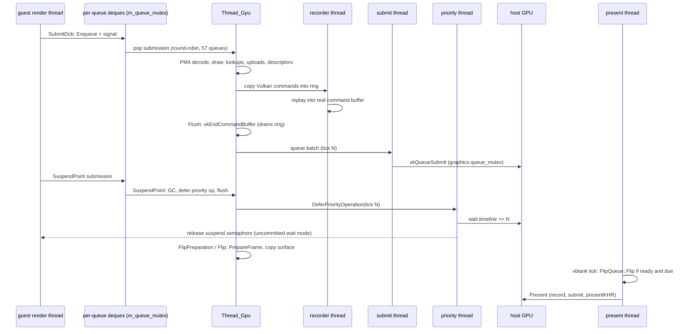

State described: c944a398 (2026-11-23), read 2026-11-25.

# Threading

Host threads, locks, waits and frame pacing. Facts come from reading the source; "hot?" and the hypotheses are marked as such. Measured numbers are only in [OPTIMIZATION_LOG.md](OPTIMIZATION_LOG.md) and keep their conditions there. Behaviour that depends on the uncommitted switch `KYTY_SUSPEND_POINT_WAIT` is marked "(uncommitted at the time of writing)".

## Host threads

"Hot?" says what is known about CPU load: **yes** = identified as a limiter or a busy loop in code or in a measurement quoted in [OPTIMIZATION_LOG.md](OPTIMIZATION_LOG.md); **no** = idle most of the time by code; **?** = not characterised.

| Thread | Created at | Role | Blocks on | Hot? |
|---|---|---|---|---|
| Process main thread (`Thread_Window`) | OS; recorded `src/common/threads.cpp:193-198` | runs `WindowRun()` after launching the execute thread (`src/emulator.cpp:135-139`, `src/graphics/presentation/window/window.cpp:868`); some managers assert `IsMainThread()` (`src/kernel/fileSystem.cpp:53`, `src/kernel/memory.cpp:663`, `src/loader/runtimeLinker.cpp:1219-1221`, sampler cache constructor) | window event loop | ? |
| Execute thread = main guest thread (`Thread_Main`, guest name `MainThread`) | detached `std::thread` at `src/emulator.cpp:135-137` | `RuntimeLinker::Execute()` then the guest entry (`src/loader/runtimeLinker.cpp:1300`, `:1349-1350`) | guest code and kernel calls | yes (it is the title) |
| Guest pthreads | `pthread_create()` at `src/kernel/pthread.cpp:3249` | guest stack, TLS, FP state, guest entry (`:3137-3186`) | kernel primitives, suspend point, vblank, labels | yes (title) |
| Detached guest-thread reaper | `src/kernel/pthread.cpp:1070` | sweeps freed detached guest threads every 10 s (`:952-960`) | `sleep` | no |
| `Thread_Gpu` (guest GPU command thread) | `std::jthread` at `src/graphics/guest_gpu/graphicsRun.cpp:41-45`, labelled `:448` | the only thread that runs the command processor and the renderer entry points ([GPU.md](GPU.md)) | `m_work_available`; 100 µs timed wait (1 ms on Windows) when every queue front is blocked; scheduler/GPU waits ([waits](#where-threads-wait)) | yes: identified as the limiter in several measurements (see [OPTIMIZATION_LOG.md](OPTIMIZATION_LOG.md)) |
| Recorder replay thread (`Thread_Recorder`) | `std::thread` at `src/graphics/host_gpu/renderer/recorder.cpp:73-75`; never joined (`:77-82`) | replays Vulkan calls copied into a 32 MiB ring into the real command buffer (`:166-211`) | spins up to 4000 `pause` iterations when the ring is empty, then a condition variable with 2 ms timeout (`:178-188`) | busy-spins by code; "keeps a core busy" is a hypothesis |
| Async submit thread | conditional `std::jthread` at `src/graphics/host_gpu/renderer/commandScheduler.cpp:553-561`, created at the first async submit; off with `KYTY_ASYNC_SUBMIT=0` (`:93-95`) | takes queued batches in tick order and calls `vkQueueSubmit` under `graphics.queue_mutex` (`SubmitThread`, `:230-262`) | its queue; one submitter at a time (`m_submit_busy`) | no (`vkQueueSubmit` costs about 28 µs each per a code comment, `:552`) |
| Priority operations thread | `std::jthread` at `commandScheduler.cpp:86-95`; joined in destructor (`:132-135`) | waits `m_master.Wait(operation.tick)` then runs the callback: guest-memory completions (read-back publish, flips, interrupts, suspend-point release) (`PriorityOperationsThread`, `:402-429`) | the host GPU timeline | no |
| Present thread (`VideoOutDriver::Impl::PresentThread`) | `std::jthread` at `src/graphics/presentation/videoOut.cpp:262-267` | virtual vblank clock, flip dispatch, present (`:809-852`) | steady-clock sleep to the vblank period; no external condition variable in its loop | ? |
| Overlay sampler | `std::jthread` at `src/graphics/presentation/performanceOverlay.cpp:208-211`, once via `call_once` | samples host stats off the present path; repaints while guest flips stall (`:176-205`) | `g_sampler_wait` | no (only with the overlay) |
| Shader-store writer | `std::jthread` at `src/graphics/host_gpu/renderer/pipeline/pipelineSerialization.cpp:113-124` | appends serialisation records, saves the driver pipeline cache at most once a minute after a creation | job queue mutex + stop token | no |
| Buffer-cache hash helpers | `std::async(std::launch::async)` at `src/graphics/host_gpu/renderer/cache/bufferCache.cpp:1706-1718` | hash up to four page ranges in parallel when ≥ 4 MiB unwatched; joined by `future::get()` per call | `future::get()` on the calling thread | ? |
| Parallel-for helpers | `std::vector<std::jthread>` in `src/common/parallelFor.h:26-30` | up to `ParallelThreads()-1` helpers per call; caller also works; used by shader-store warm-up | joined at scope end | start-up only |
| APR and AMM command engines | static `std::jthread` ×2, `src/libs/libAmpr.cpp:1225-1226`, `:1332-1333` | priority queues, one command at a time | condition variable; 100 µs timed wait for unsatisfied waits (`:1228-1267`) | ? |
| Archive I/O | detached `std::thread`, `src/common/archive.cpp:208-210` | async archive reads | per-request condition variables | no |
| Patch hold thread | `std::thread(HoldWrites)`, `src/loader/gamePatch.cpp:358`; joined by `StopHolding()` (`:57-64`) | repeatedly compares and rewrites selected guest locations (`:68-79`) | loop (sleep interval not read) | ? |
| Windows signal-handler dispatch | detached `std::thread` per non-guest-context signal, `src/libs/libKernel.cpp:1013-1019` | runs a guest exception handler carrying TCB and guest-self | — | no |
| Audio3d playback simulation | detached `std::thread` per port, `src/libs/audio3d.cpp:163` | semaphore wait, modelled sleep, slot release | semaphore | no |
| Controller audio sender | `SDL_CreateThread`, `src/libs/dualSenseBluetooth.cpp:364`, lazy | controller speaker/haptics | ? | no |
| SDL audio stream callbacks | managed by SDL (`src/libs/audio.cpp:269-276`) | audio output | — | ? |
| OpenXR headset thread | `std::thread(ThreadMain)`, `src/graphics/presentation/openxrHeadset.cpp:685-687`; joined at shutdown | headset runtime loop | body not read | ? |

Deferred priority operations run on the priority thread, deferred normal operations run on the GPU thread inside `PopPendingOperations` (`commandScheduler.cpp:316-344`, `:402-429`).

## Locks

Lock names as in the source. "Held across" names the longest operation seen under the lock.

| Lock | Protects | Taken by | Held across |
|---|---|---|---|
| `g_memory_operation_mutex` (recursive) | whole guest memory operations | guest threads in allocate/protect/free/map | a whole memory operation (allocation, protection, free work); the comment at `src/kernel/memory.cpp:177-181` promises only that the state mutex is not held across a graphics call, a callback or a guest memory access, nothing like that is stated for this lock |
| `g_memory_state_mutex` (shared) | address-space map | shared: every protection call (`ProtectTransient`, `src/kernel/memoryAddressSpace.inc:633-636`); exclusive: map/unmap/commit | state changes only; tracker protection calls and title memory calls exclude each other |
| linker mutex | symbol database, program list | load/resolve (`src/loader/runtimeLinker.cpp:1227-1266`, `:1380-1419`) | load and resolve |
| guest-instruction patcher per-module mutex | patching | loader (`src/loader/guestInstructionPatcher.cpp:1536-1569`) | patching a module |
| file-system `Common::Mutex` + per-file mutex | mount points, descriptor tables; one open file | guest file calls (`src/kernel/fileSystem.cpp:44-103`) | host file read/write per call |
| guest mutex/semaphore/event-flag/event-queue internals | their own waiter lists | guest threads | condition-variable waits, re-checked every 10 ms (`src/kernel/pthread.cpp:1231-1288`, `src/kernel/semaphore.cpp:207-233`); a signal wakes the waiter at once (details: [CPU.md](CPU.md#sync-primitives-and-timers)) |
| APR submission mutex + condvar | APR submissions | guest threads, APR engines (`src/libs/libAmpr.cpp:295-318`) | worker completion wait |
| NGS2 `g_ngs_mutex`, `g_racks_mutex`, system mutex, user lock | systems, racks, one system's render | guest audio threads (`src/libs/ngs2.cpp:1419-1424`, `:3280-3337`) | one grain of rendering (system mutex) |
| AJM global mutex | decoder instances | guest threads (`src/libs/ajm.cpp:191-201`, `:436-454`) | a whole decoder call |
| AudioOut2 per-context mutex | context queue | guest threads (`src/libs/libAudio2.cpp:213-229`) | queueing; pacing sleeps are outside it by the comment |
| `GuestGpu::m_queue_mutex` (+ `m_work_available`, `m_idle`) | 57 submission deques, deferred command deque, flags | guest threads `Enqueue`/`SendCommand`; GPU thread (`src/graphics/guest_gpu/graphicsRun.cpp:425-435`, `:460-547`) | queue manipulation; not held while waiting at a suspend point |
| `m_suspend_point_ready` (binary semaphore, initial 1) | one-frame lookahead | guest render thread acquires; released by CP or a priority operation (`graphicsRun.cpp:151-160`, `:576-584`) | whole frame interval |
| Render context mutex (`m_context.GetMutex()`) | the whole draw/dispatch preparation and recording | GPU thread in `RenderExecutor::DrawIndex`, `DrawAuto`, `DispatchDirect` (`renderDraw.cpp:1281`, `:1372`; `renderCompute.cpp:328`) | an entire draw, including cache lookups, uploads and Vulkan recording |
| `graphics.queue_mutex` | the main Vulkan queue | submit thread/GPU thread submit; `Swapchain::Present` (`swapchain.cpp:901-931`) | `vkQueueSubmit`, `vkQueuePresentKHR` |
| `m_submit_busy` flag | single submitter | submit thread, or a thread submitting up to a tick itself (`commandScheduler.cpp:265-287`) | one submit |
| recorder ring | lock-free single producer / single consumer; mutex + `notify_one` only to wake a sleeping consumer (`recorder.cpp:140-143`) | GPU thread (producer), recorder thread | — |
| `RegionManager::lock` (spin, per 4 MiB, `TrackingSpinLock`) | dirty/hot bit arrays, generation | guest fault threads, GPU thread (`src/graphics/host_gpu/regionManager.h:35-81`, `:482`) | busy-wait; GPU thread holds it across the upload copy of written ranges and across `VirtualProtect` calls |
| PageManager `Region::lock` (atomic flag, per 4 MiB) | watcher counts | any thread changing watchers (`pageManager.cpp:132`) | nested inside the one above; `WriteGuest` holds it across its memcpy (`:352-369`) |
| `TextureCache::m_lock` (`TrackingSpinLock`) | image slots, page table, metadata, download set | GPU thread for all of `FindImage`/`FindTexture`/`Find*Target`/`RefreshImage`; guest fault threads when an image is on the written pages | a whole upload, detile dispatch recording and stream-buffer waits |
| `m_write_back_mutex` | `m_write_backs` | GPU, priority thread, fault path | short |
| `m_bda_sync_mutex` | `m_bda_sync`, `m_bda_unwatched`, `m_gpu_owned`, `m_bda_entry_pending` | every guest write fault, `Register`, GPU `SynchronizeBda` | short, taken per fault |
| `m_bda_scan_mutex`, `m_cp_known_mutex`, `HotPages::m_release_mutex`, `m_region_mutex`, `OncePublish::mutex` | named sets | see [MEMORY.md](MEMORY.md#locks-of-this-area) | short |
| `RenderContext::m_mapped_ranges_mutex` (shared) | mapped GPU ranges | shared: every fault (`IsMapped`), all of `PrepareBda`; exclusive: `MapMemory`/`UnmapMemory` | `SynchronizeBda`; a title map/unmap waits for it |
| Flip queue / vblank state (`vblank_cond` and its mutex) | flip requests, vblank counter | present thread, guest threads, GPU thread | not read in detail (member names not recorded) |
| Shader store writer mutex; `g_shader_map` mutex; learned-programs mutex | store queue; shader metadata; learned set | writer, GPU thread | short |

Unlocked by design: BufferCache maps, slot vectors, `m_gpu_modified_ranges`, eager lists and memos (GPU-thread-only, `bufferCache.h:101`); `SamplerCache` (created on the main thread).

## Where threads wait

"Who" = the waiting thread. Owner of the details is the document in the last column.

| Who | Waits for | Where | Detail |
|---|---|---|---|
| Guest render thread | the previous frame's suspend point to be released | `GuestGpu::SuspendPoint` acquires `m_suspend_point_ready` (`graphicsRun.cpp:151-160`). Release: at CP completion of the point in the committed tree; with the host GPU finished when `KYTY_SUSPEND_POINT_WAIT` is unset or not `0` (uncommitted at the time of writing) via a priority operation (a `DeferPriorityOperation` in the `SuspendPoint` case of `GuestGpu::Process`, committed case at `:576-584`) | [Frame pacing](#frame-pacing-chain) |
| Guest threads | `WaitForIdle` | `graphicsRun.cpp:437-443` | [GPU.md](GPU.md) |
| Guest threads | vblank | `VideoOutWaitVblank` on `vblank_cond` (`videoOut.cpp:1693-1708`) | [GPU.md](GPU.md) |
| Guest threads | flip events / labels | RELEASE_MEM label (`src/libs/agc.cpp:4023-4032`), flip event (`videoOut.cpp:1182`) | [GPU.md](GPU.md) |
| Guest thread | GPU thread to reach a packet boundary and finish a download | `GuestGpu::SendCommandSync` semaphore (`graphicsRun.cpp:105-117`) for guest read/write of a GPU-dirty page (`BufferCache::ReadMemory`, `bufferCache.cpp:346-404`) | [MEMORY.md](MEMORY.md#from-a-guest-write-fault-to-the-resumed-instruction) |
| Guest thread | region / texture spin locks | spin on `RegionManager::lock`, `TextureCache::m_lock` | [MEMORY.md](MEMORY.md#locks-of-this-area) |
| Guest thread | map/unmap waits for `PrepareBda` | `m_mapped_ranges_mutex` exclusive vs shared | [MEMORY.md](MEMORY.md) |
| GPU thread | work | `m_work_available` (`graphicsRun.cpp:460-465`); 100 µs timeout (`WaitFor` takes microseconds; 1 ms on Windows) when every front is blocked (`:484-492`) | [GPU.md](GPU.md) |
| GPU thread | a suspended WAIT_REG_MEM / MEM_SEMAPHORE | the submission is marked blocked and re-queued at the front (`:274-299`, `:540-546`) | [GPU.md](GPU.md) |
| GPU thread | a free flip-queue slot | `Sync::PrepareVideoOutFlip` retries `SubmitFlipFromGpu`, calling `WaitForSubmitSlot` (`sync.cpp:52-70`; `videoOut.cpp:1066-1089`); capacity 16 (`videoOut.cpp:66`) | [GPU.md](GPU.md) |
| GPU thread | the host GPU (timeline semaphore) | `CommandScheduler::Wait(tick)` (`commandScheduler.cpp:297`; submits the open batch first if `tick == CurrentTick()`), `Finish` (`:181`), `MasterSemaphore::Wait` → `vkWaitSemaphores(UINT64_MAX)` (`masterSemaphore.cpp:41-63`) | [GPU.md](GPU.md) |
| GPU thread | priority operations | `WaitPriorityOperations(tick)` before a normal deferred operation of tick T (`commandScheduler.cpp:341`) | [GPU.md](GPU.md) |
| GPU thread | host GPU, via callers of `Wait`/`Finish` | `BufferWait` (`graphicsRun.cpp:241`), GDS read (`:1087`), `UnmapMemory` (`renderContext.cpp:146`), shutdown (`:48`), `WaitWriteBacks` (`renderContext.cpp:86-99`), sync `DownloadBufferMemory<false>` (`bufferCache.cpp:264-267`), eager-download completion (`:1451`, `:1456`, `:1491`), buffer GC at critical level (`:1598-1599`), texture GC download (`textureCache.cpp:2303-2305`), `StreamBuffer` wrap (`streamBuffer.cpp:337-339`), fault-buffer area reuse (`faultManager.cpp:68-72`), ray-tracing readback area (`rayTracing.cpp:398-402`), occlusion publish (`occlusionQueries.cpp:57`) | [GPU.md](GPU.md), [MEMORY.md](MEMORY.md#hypotheses-and-candidates) |
| GPU thread | the side queue | `WaitSide` (calls `SubmitQueuedUpTo(UINT64_MAX)` first, `commandScheduler.h:80-83`); next main submit waits `m_side >= N` at `eAllCommands` (`commandScheduler.cpp:537-540`) | [GPU.md](GPU.md) |
| GPU thread | the recorder thread | `Drain` spins/yields until `m_done >= target`; drains at `vkEndCommandBuffer` (once per batch), command-buffer/pool reset, every listed `vkDestroy*`, `vkFreeMemory`, acceleration-structure build, trace-rays (`recorder.cpp:147-156`, `:573-652`, `:1229-1285`); also when the ring is full (`Reserve`, `:97-123`) | [GPU.md](GPU.md) |
| GPU thread | the submit worker | `DrainSubmits()` when async submit is off or the caller is not the GPU thread (`commandScheduler.cpp:535-568`); `SubmitQueuedUpTo` submits queued batches itself rather than wait (`:265-287`) | [GPU.md](GPU.md) |
| GPU thread | other threads' `SendCommand` closures | runs queued commands between packets (`ProcessCommands`, `graphicsRun.cpp:665`) | — |
| Present thread (via `Presenter`) | swapchain image and frame pool | frame pool waits `present_tick` (`swapchain.cpp:105`), acquire waits the semaphore-ring slot's tick (`:579`), destructor waits the last tick (`:52`), `presentKHR` under `graphics.queue_mutex` (`:901-931`) | [GPU.md](GPU.md) |
| Priority thread | host GPU timeline | `m_master.Wait(tick)` per operation | — |
| Buffer-cache scan caller | hash helper threads | `future::get()` (`bufferCache.cpp:1706-1718`) | [MEMORY.md](MEMORY.md) |
| Audio guest threads | output queue below target | 1000 µs sleeps (`src/libs/audio.cpp:365-406`), `SleepMicro` loop (`libAudio2.cpp:626-664`) | [CPU.md](CPU.md#audio) |

## A frame across threads

The side queue (early compute) runs beside the main queue: the GPU thread records a learned producer dispatch into a side command buffer, `SubmitSide()` submits it on `graphics.side_queue` signalling timeline `m_side`, and the next main submit waits on it (`commandScheduler.cpp:491-540`).

## Frame pacing chain

1. **Suspend point.** At each frame boundary the guest render thread calls `AgcSuspendPoint` → `GuestGpu::SuspendPoint`: it acquires `m_suspend_point_ready` (initial 1, so the first point returns at once), enqueues a `SuspendPoint` submission and increments the completed-frame counter (`src/libs/agc.cpp:1513-1519`, `graphicsRun.cpp:151-160`, `graphicsRun.h:88`, `:93`).
2. **Release.**
   - Committed tree (c944a398): the semaphore is released when the command processor has executed the point, i.e. after every packet before it was processed ([OPTIMIZATION_LOG.md](OPTIMIZATION_LOG.md) records the 2026-11-23 merge that introduced this).
   - Working tree (uncommitted at the time of writing): `SuspendPointWaitsForGpu()` reads `KYTY_SUSPEND_POINT_WAIT` once; unset or first character not `0` → the release is a priority operation that runs when the host GPU finished the work before the point, so the guest prepares at most one frame ahead of the host GPU. `KYTY_SUSPEND_POINT_WAIT=0` releases right after `BufferFlush`/`Reset` (`SuspendPointWaitsForGpu` and the `SuspendPoint` case of `GuestGpu::Process`, which replaces the committed `:576-584`).
   - In both modes the GPU thread first runs the render garbage collector (`:578`).
3. **Flip queue.** `set_flip` encodes a flip packet; the command processor recognises it in `CpOpSetUconfigReg` and calls `CommandProcessor::Flip`, which calls `Sync::PrepareVideoOutFlip` (reserve a request, `FlipQueue::Prepare` → `Presenter::PrepareFrame`: acquire a frame, copy the surface into it), defers `CompleteFlip` and flushes the scheduler (`src/libs/agc.cpp:3986-4036`, `pm4Handlers.cpp:1273-1313`, `graphicsRun.cpp:1193-1206`). The CPU path `VideoOutSubmitFlip` enqueues a `FlipPreparation` submission instead (`videoOut.cpp:1517-1533`). `FlipQueue::Reserve` replaces superseded slave requests and rejects at 16 pending (`:854-919`). `FlipQueue::Complete` marks the request `Ready` (`:1046-1064`).
4. **Virtual vblank.** The present thread's period is 1 s divided by `Config::GetVblankFrequency()` (default 60, clamped 30..360); it sleeps to the next tick, calls `VblankBegin`, tries `FlipQueue::Flip()`, may re-present the last or a blank frame for the system overlay, calls `VblankEnd` (counts vblank, fires events, signals `vblank_cond`) and counts `LateVblanks` when it falls behind (`videoOut.cpp:775-852`; `src/common/emulatorConfig.cpp:148-150`).
5. **Flip due.** `FlipQueue::Flip` waits until every member of a group is `Ready`, checks generation and `IsFlipDueLocked`, calls `Presenter::Present`, fires flip events (`videoOut.cpp:1092-1199`). A flip is due after `flip_rate + 1` vblanks, or at once when the interval is ≤ 1 or `IgnoreFlipRate` is set (`:490-497`); `VideoOutSetFlipRate` accepts 0..2 (`:1260-1282`).
6. **Present.** `Presenter::Impl::Present` acquires a swapchain image, records the blit/draw, submits and calls `presentKHR`, retrying twice on recreate/lost (`swapchain.cpp:1042-1097`). The present mode is Mailbox by default with a Fifo fallback (`:436-450`, `emulatorConfig.h:66`).
7. **Guest wake-up.** The title sees completion through the RELEASE_MEM label (`agc.cpp:4023-4032`), flip events (`videoOut.cpp:1182`) and vblank waits (`:1693-1708`). A flip that arrives before all group members are ready is deferred without presenting (`:1103-1110`).

A frame that misses a vblank tick waits for the next one; with a 60 Hz clock this quantises flips (measured: [OPTIMIZATION_LOG.md](OPTIMIZATION_LOG.md), 2026-11-12, `--vblank-frequency 120`). Frame IDs are not a separate pacing primitive; the present thread period and the Vulkan present mode pace presentation (`videoOut.cpp:809-852`).

## Contention and serialisation hypotheses

Not measured unless a source in [OPTIMIZATION_LOG.md](OPTIMIZATION_LOG.md) is named.

| # | Hypothesis | Mechanism (fact) |
|---|---|---|
| 1 | The render-context mutex serialises every draw and dispatch on one thread | one mutex across cache lookups, descriptor resolution and recording (`renderDraw.cpp:1281`, `renderCompute.cpp:328`) |
| 2 | Guest fault threads spin while the GPU thread holds a region or texture lock | busy-wait locks held across upload copies and `VirtualProtect` (`memoryTracker.h:196-218`, `textureCache.cpp:1911-1912`) |
| 3 | A suspended WAIT_REG_MEM wakes only on the 100 µs poll (1 ms on Windows), and the GPU thread spins through it while every front is blocked | no other notifier found in the files read (`graphicsRun.cpp:484-492`) |
| 4 | Recorder drains put the GPU thread idle behind the recorder thread | drains at every batch end and every destroy |
| 5 | The recorder thread's spin loop occupies a core | 4000 `pause` iterations before sleeping |
| 6 | Guest-thread suspend-point wait limits lookahead to one frame; the wait is CPU-side | semaphore released by a priority operation (uncommitted wait mode) |
| 7 | Global memory lock serialises title memory calls against tracker protection calls | `g_memory_operation_mutex` and `g_memory_state_mutex` |
| 8 | A map/unmap by the title waits for a running `PrepareBda` | exclusive vs shared `m_mapped_ranges_mutex` |
| 9 | Parked guest waiters wake every 10 ms to re-check (extra wake-ups, not extra wake latency) | see [CPU.md](CPU.md#candidates-for-cpu-cost-hypotheses-not-measured) |
| 10 | The GPU thread waiting on the host GPU for reads of GPU-written data is the dominant stall in some scenes | wait list above; measured in [OPTIMIZATION_LOG.md](OPTIMIZATION_LOG.md) |

## Not covered yet

- Member names and locks inside `FlipQueue` and the `vblank_cond` mutex (`src/graphics/presentation/videoOut.cpp` read at the cited ranges only).
- Whether the swapchain presents on `graphics.queue` and whether presentation interacts with the side-queue semaphore (`swapchain.cpp` read only at wait sites).
- Sleep interval of the patch hold thread; join behaviour of the controller audio thread; OpenXR thread body.
- How many SDL audio callback threads exist and on which cores.
- Which thread executes `DeferOperation` callbacks beyond the GPU thread's `PopPendingOperations` (the code cited above runs normal operations on the GPU thread; priority operations run on the priority thread).
- Wake-up path of a suspended WAIT_REG_MEM from a guest CPU write (only the 100 µs / 1 ms poll was found).
- Exact semantics of `VideoOutWaitVblank` under multiple ports when a flip is skipped.
- Lengths of GPU-thread lock holds and packet duration distribution (unmeasured).
- Per-thread CPU time of the helper threads in a real run.
